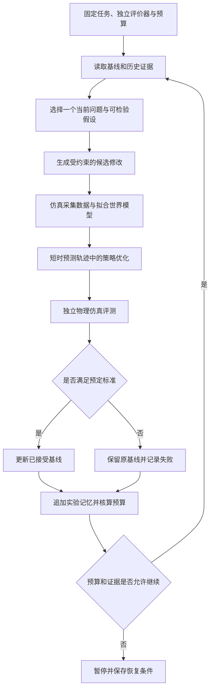

# SuperMimic 中文调研与机器人 RSI 研究方案

- 日期：2026-11-09（新加坡时间）。
- 文档性质：方法调研与研究设计草案。
- 验证对象：拟以 MicroDuck 为主要实验平台，具体模型、执行器与计算资源待实验前确认。
- 状态：尚未执行本文提出的训练、仿真对照或真机实验；研究假设不代表已取得的结果。

## 1. 研究摘要

SuperMimic 是一种用于人形机器人动作跟踪的基于模型的强化学习方法。它的核心思路是：先学习一个描述机器人如何运动的可微动力学模型，再利用短时“想象”轨迹优化控制策略。

本方案围绕两个递进问题展开：

1. 可微世界模型能否在相同预算下，提高 MicroDuck 动作跟踪的学习效率？
2. 能否把模型误差、控制失败和历史实验结果组织为证据，驱动下一轮改进，并进一步改善实验决策机制本身？

第一问研究控制学习，第二问研究实验自改进及机器人 RSI。策略训练、自动调参和反复运行实验，不自动构成递归自我改进的证据。

## 2. 论文与资料入口

**论文原名：** *SuperMimic: Scaling Humanoid Whole-Body Control with One Differentiable World Model*。

**中文译名：**《SuperMimic：通过单一可微世界模型扩展人形机器人全身控制能力》。此中文标题为本文译名。

**作者：** Qiayuan Liao、Yiyang Shao、Junfeng Long、Kevin Zakka、Roberto Horowitz、Pieter Abbeel、Koushil Sreenath。

| 资料 | 链接 | 使用方式 |
|---|---|---|
| 原论文摘要页 | <https://arxiv.org/abs/2610.28480> | 方法与实验结论的原始入口 |
| 原论文 PDF | <https://arxiv.org/pdf/2610.28480> | 实现前核对公式、观测、奖励、数据划分和评测协议 |
| 项目与演示 | <https://supermimic.github.io/> | 查看作者展示的任务和运行效果 |
| SuperMimic 独立复现 | <https://github.com/CuboiLeo/SuperMimic-Reproduced> | 参考实现、实验记录和失败分析；与原论文区分 |
| 另一份独立复现 | <https://github.com/zita-ch/supermimic_vibed> | 比较工程选择和评测条件；不作为官方实现使用 |
| MorphMimic 作者仓库 | <https://github.com/lzyang2000/morphmimic> | 了解多机器人共享世界模型与策略的扩展 |

调研边界：本次整理读取了可访问的 GitHub 资料，包括 MorphMimic 作者说明及 SuperMimic 复现记录；原论文站点和项目站点在当前环境中访问受限。本文不声称已完成原论文全文逐式审读，也不将复现者的结果归为原论文结果。正式实现前需固定论文版本、代码提交、数据版本和评测协议，并再次核对原文。

本文不以“训练多少小时”“成功率多少”等二手数字作为方案依据。不同硬件、动作集、观测输入、碰撞设置和评测条件下的数字，不能直接比较。

## 3. SuperMimic 的工作原理

### 3.1 两个主要学习组件

| 组件 | 输入与输出 | 作用 |
|---|---|---|
| 世界模型 | 当前物理状态、动作及必要环境条件 → 下一状态预测 | 学习动作对机器人运动的影响 |
| 控制策略 | 机器人观测与参考动作 → 控制动作 | 使机器人跟踪目标运动 |

世界模型预测的是机器人身体的物理状态，例如关节状态、姿态和速度，并非生成视频。训练时可使用完整仿真状态；部署时策略可获取的传感器观测是另一项接口约定，两者不能混同。

### 3.2 交替训练过程

1. **采集仿真经验。** 策略在物理仿真器中控制机器人，产生“当前状态—动作—下一状态”的数据。
2. **拟合世界模型。** 使用采集的数据学习动力学，检验单步及多步预测能力。
3. **通过预测轨迹优化策略。** 从已有状态出发，在世界模型中生成短时轨迹，利用沿轨迹反向传播的梯度调整策略。
4. **回到物理仿真验证。** 用更新后的策略获取新数据，继续交替更新。

策略更新阶段可以固定世界模型参数，同时让梯度经过世界模型传回策略。这样既能利用预测动力学提供的梯度，也避免把“修改预测结果”误当成“改进控制策略”。具体更新顺序和目标函数应以固定版本论文及实现为准。

**物理仿真器本身不需要可微。** 可微的是学到的动力学近似模型，真实的接触和碰撞仍由物理仿真产生训练数据并承担验证。

### 3.3 与 PPO 的差异

PPO 主要依据采样轨迹及回报估计策略改进方向。SuperMimic 类方法进一步利用世界模型中的动力学梯度，优化动作对后续运动的影响。这可能减少达到目标性能所需的仿真交互，但也增加了模型训练和预测轨迹计算的成本。

因此，需要分别比较交互样本效率、实际耗时和总计算开销，不能把采样量减少直接等同于训练更快。

### 3.4 “想象”的含义与边界

这里的“想象”是世界模型中的短时状态预测，主要用于训练。部署时可以直接运行训练好的策略，不必在每个控制时刻执行在线规划搜索。

“单一世界模型”指共享动力学支持同一机器人上的多种动作技能，不自动意味着能够控制任意新身体。它也不意味着具备语言推理、任务规划或自主科研能力。

若用“System0”描述快速、持续的底层运动控制，可以把它作为理解上的比喻；本文不把它视为已核实的 SuperMimic 正式架构定义。

## 4. 局限与 MorphMimic 的启发

### 4.1 模型误差与长时表现

接触、冲击、足部滑动和未覆盖的状态都可能造成模型误差。策略可能利用这些误差，使预测轨迹中的回报升高，而物理仿真表现没有改善。短时预测有助于限制误差累积，但不能代替独立验证。

状态预测误差低，也不保证动作对应的梯度方向准确。必须把预测精度、梯度驱动的策略更新和实际控制收益分别评估。

独立复现资料记录了长动作中的漂移问题，其结果与观测中是否提供参考锚点信息有关。这说明动作片段长度、状态可观测性和坐标定义都应单独检查；不能仅凭模型误差较低或短动作得分较高，推断长时控制可靠。

### 4.2 MorphMimic 的扩展与适用范围

根据作者仓库，MorphMimic 基于对 SuperMimic 的独立实现，研究 G1、X2 Ultra 和 T2 之间共享世界模型、策略或两者。网络接收增益、限位、肢体长度和质量等身体参数，并通过统一关节布局连接多个机器人。

需要区分三个事实：

- 对已参与训练的多个机器人共享策略，不等于对任意未见机器人实现零样本迁移。
- 人体目标接口可以免去在线动作重定向，但训练数据准备仍包含动作重定向。
- 作者说明真机验证覆盖 G1；X2 Ultra 与 T2 的对应结果仍限于仿真。

对 MicroDuck，应优先研究节拍、接触时序、身体朝向和根部轨迹等可迁移特征，再按自身结构构造动作目标，不能直接套用 G1 关节角或预训练权重。

## 5. 机器人 RSI 的操作性定义

本方案把改进过程分为三个层次：

| 层次 | 改进对象 | 所需证据 |
|---|---|---|
| 动作学习 | 策略参数 | 在固定任务与标准上表现改善 |
| 实验自改进 | 配置、采样、模型或训练方案 | 系统依据证据提出修改，经独立验证后保留有效候选 |
| 递归自改进 | 诊断规则、实验选择或搜索机制 | 改进后的研究机制在后续独立任务上提高改进效率 |

本研究先建立前两层，再检验第三层。只有策略权重更新、自动修改奖励、自动生成代码或重复训练，都不足以单独证明 RSI。

## 6. 研究假设

**H1：学习效率。** 在固定任务、硬件和总预算下，SuperMimic 类训练器比 PPO 更快达到预先规定的跟踪与稳定性标准。

**H2：证据驱动的实验选择。** 联合世界模型预测误差、动作跟踪误差和接触信息，能够更有效地定位问题，并提高单位预算内的有效改进数量。

**H3：研究机制的可迁移改进。** 经验证更新的诊断与实验选择规则，在未用于规则开发的动作或工况上，优于原始固定规则及随机搜索。

H1 不成立时仍应报告适用条件和失败原因。H2 成立不代表 H3 自动成立。每项假设分别制定验收标准，保留否定结果。

## 7. 系统设计：学习内循环与研究外循环

学习内循环负责数据采集、世界模型训练与策略更新；研究外循环由实验 Harness 组织，负责问题选择、预算管理、候选比较和经验保存。

### 7.1 角色分工

| 模块 | 职责 |
|---|---|
| 执行适配器 | 调用 PPO 或世界模型训练器，记录实际版本与参数 |
| 诊断器 | 对齐预测误差、运动误差、接触事件和失败时间 |
| 实验协调器 | 选择下一动作、检查预算、组织候选实验 |
| 独立评价器 | 按冻结的任务与标准判断候选是否成立 |
| 实验存储 | 保存证据、配置、权重索引、结论和父子关系 |

候选方案不能通过修改自己的测试集或降低验收门槛获得接纳。研究规则的更新也要作为候选，接受独立验证。

### 7.2 初期允许的修改范围

第一阶段限制为想象轨迹长度、世界模型损失权重、困难片段采样比例及训练超参数。每轮检验一个主要假设，并限制预算。

奖励定义、观测接口、评价器或机器人结构的变化应单独建立实验版本。增加额外观测时，应明确它是否能在实际部署中获得；不能把信息优势归因于训练算法本身。

## 8. 分阶段实验路径

### 阶段 A：建立 PPO 基线

固定一段 MicroDuck 舞蹈、机器人模型、控制频率、执行器配置与参考轨迹。先验证平地，再加入固定 4° 坡度和坡向。

保存配置、checkpoint、归一化状态、模型版本及完整评测轨迹。明确仿真提供的信息和真机可获取的信息。

### 阶段 B：引入世界模型训练器

保持参考动作、控制接口和任务标准一致，尽量对齐策略容量及观测信息。记录数据准备、模型拟合、策略更新、编译预热和必要评测的耗时，并分项披露。

同时提供等交互样本量与等总预算的比较。原论文或其他机器人上的成功结果，不作为 MicroDuck 已通过验证的依据。

### 阶段 C：建立误差与失败诊断

分别评估单步和多步预测，并按支撑、离地、落脚和快速姿态变化分组。记录根部和足部世界坐标、接触状态、预测轨迹、实际轨迹及真实加载的 checkpoint。

先用固定策略做诊断，区分参考动作不可实现、模型预测错误、观测不足、执行器接口错误和接触滑动，再决定是否训练。

### 阶段 D：加入受约束的自动实验闭环

例如，当前假设为“支撑转换阶段样本不足，造成预测误差扩大”。候选修改仅提高对应片段的采样比例，其他条件保持一致，再由独立评价器判断控制表现是否改善。

如果误差下降但动作表现没有改善，应保留这一反证，不能仅凭中间指标接纳候选。

### 阶段 E：检验研究机制本身

在同等预算下比较固定人工规则、随机搜索和可更新实验规则。固定候选空间及信息访问条件，记录所有诊断、失败作业与评测成本。

规则更新完成后冻结，在未参与开发的动作或工况上测试。检查有效改进率、改进幅度和总成本，判断规则改进是否具有迁移价值。

## 9. 评价指标与实验约束

| 评价对象 | 主要指标 |
|---|---|
| 动作完成 | 完成率、摔倒率、首次失败时间 |
| 跟踪质量 | 关节、身体姿态及关键部位轨迹误差 |
| 稳定性 | 根部漂移、支撑脚滑动、长时连续表现 |
| 执行代价 | 动作抖动、力矩或功率相关指标 |
| 世界模型 | 分运动阶段的单步及多步预测误差 |
| 学习效率 | 达到固定标准所需时间、交互样本量和计算成本 |
| 研究效率 | 单位预算内的有效改进数量、幅度及无效实验比例 |

评价必须同时检查动作幅度与完成质量，防止通过少动或不动降低漂移。参考动作本身有移动时，应测量相对参考轨迹的偏差，不能把一切根部位移都视为错误。

使用多个独立随机种子，预先确定重复次数与汇总方法，并报告波动。分别划分训练动作、开发验证动作和最终测试动作，避免根据最终测试结果反复调参。

训练奖励变化后，不直接比较新旧总回报。碰撞开关、终止条件、动作片段长度、域随机化和额外状态信息均需记录。仿真通过、跨仿真通过与真机通过分别报告。

MorphMimic 作者记录过后期 checkpoint 在真机站立时出现摇摆、训练指标却未反映的问题。这进一步说明应独立验证候选，保留可回退基线，不将训练曲线单独作为部署依据。

## 10. 实验记忆与跨轮继承

每轮至少保存任务与评价器版本、代码提交、机器人模型、完整配置、随机种子、父 checkpoint、模型与策略权重索引、数据版本、成本、轨迹、失败片段及接纳结论。

下一轮状态应明确：已接受基线、当前问题、当前假设、支持与反证、剩余预算，以及下一动作是诊断、训练、评测、补测还是暂停。

诊断规则和实验选择规则也必须版本化。只有在独立比较后才替换旧规则，避免错误经验逐轮累积。

相关设计可参见本仓库的[实验结果继承与训练 Harness 方案](如何让一次实验的结果能成为下一次实验的输入.md)。

## 11. 与 CAD 和身体改进的连接

第一阶段固定机器人结构，先研究控制学习和实验闭环。

后续若引入 CAD 修改，必须同步质量、惯量、碰撞模型、关节限位和执行器约束。仅修改 STEP 外形不能证明控制改善。新身体还会改变动力学分布，需要重新验证世界模型，必要时采集数据并训练。

形态方案比较应核算重新建模、数据准备和训练成本。跨身体共享模型的结果不能替代新结构的可靠性验证。

## 12. 预期产出与结论边界

预期产出包括可复现的 PPO 与世界模型基线、独立评价器、版本化实验记录、失败分类与诊断报告，以及解释每次接纳或拒绝决定的证据包。

如果仅证明训练更快，结论限定为学习效率提升。如果系统能依据证据完成有效实验闭环，可称为受约束的实验自改进。只有研究机制的修改能在后续独立任务上持续提高改进效率，才有依据进一步讨论机器人 RSI。

启动实验前仍需确认 MicroDuck 的具体动力学模型、动作数据、传感器与控制接口、GPU 条件、总预算和验收门槛。本文不预设这些条件已经具备。
