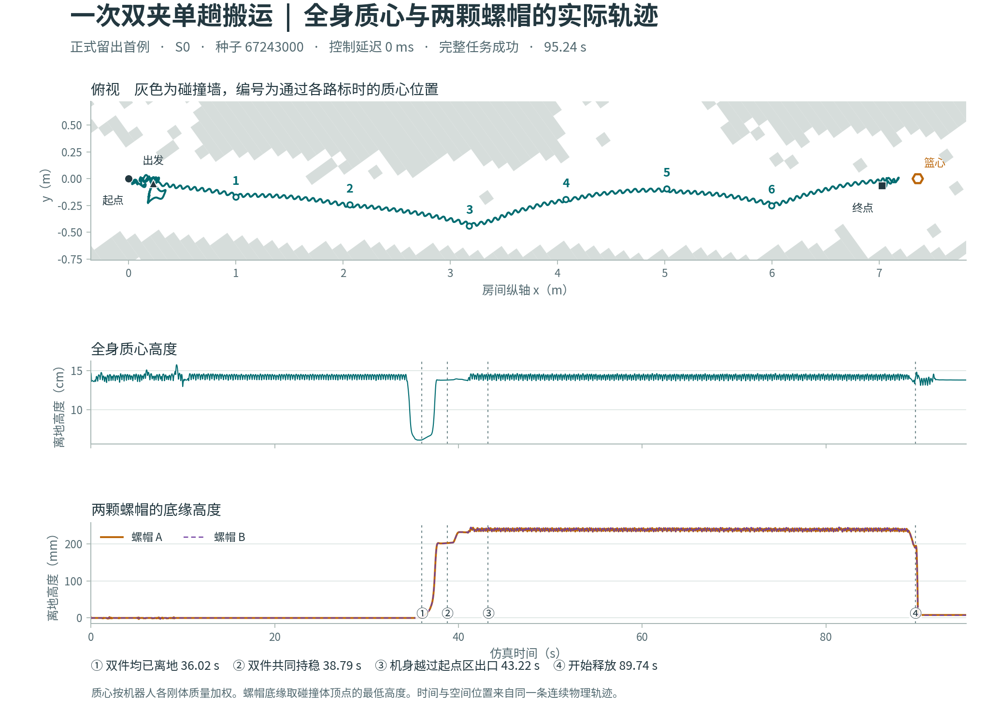

# 起距 200 毫米的双螺帽，一次双夹单趟投篮

**MuJoCo 正式验收为 239/240（99.58%），Wilson 95% 区间为 97.68%–99.93%。** S0 无附加延迟组为 39/40，另外五组均为 40/40，各组都达到事先规定的 38/40。每个起点只计一次。成功回合的仿真用时中位数为 73.78 秒，P90 为 89.22 秒。[逐组结果](verdict.json) · [240 个逐例结果](heldout.csv)

## 看一次完整操作

[下载正式首例原速全程录像](replay.mp4)。回放使用留出种子 67243000，保留了从地面初始摆位到篮内共同承托的整个过程。金色、紫色分别代表螺帽 A、B。

| 仿真时刻 | 物理事件 |
|---|---|
| 0–10.26 s | 两件中心距约 200 mm，各自有地面承托。鸭子用足缘推拢并撤脚，中心距降至约 21.07 mm。 |
| 34.26–39.34 s | 调整站位后一次闭喙，B 在 36.010 s、A 在 36.025 s 首次持续离地，随后两件一起夹稳。 |
| 43.215–81.18 s | 鸭子带双件越过固定起点出口，依次通过六个路标。 |
| 89.74–95.24 s | 松喙放入同一篮，后退站稳。结束时两件已共同获得约 4.74 s 篮内承托。 |



## 控制器怎么学会用脚

足缘控制器在相同场景状态的动力学副本里比较步幅、推拨方向和撤脚动作。开发初期有些动作能把两颗推近，却会在收脚时把其中一颗踢离地面。把撤脚后双件能否静稳加入候选筛选，才获得可用于下一步双夹的姿态。另一组同状态试验发现，带载时只给偏航容易停在原地；同时给少量前移、侧移和偏航，恢复了交替支撑。最后再用完整运输与放篮预演筛掉夹得起、走不稳的动作。正式轨迹从同一初态执行一条电机指令序列，副本只参与选动作。

在同一批 12 个开发摆位上，扩充归拢候选并加入运输预演使全程完成数从 5 增至 11。随后冻结控制器、地图、评分与新种子进行正式验收。239 个正式成功回合中，168 例采用第一类足推搜索，71 例采用另一类足推搜索。开发中还验证过张开喙、用上颌侧拨的备选动作。[归拢候选选择](controller/combined_gather.py) · [足推动作](controller/mpc_foot.py) · [控制器配置](settings.json) · [拾取参数](parameters.json)

## 如何判定成功

- 两颗独立自由体各重 0.993 g。在固定鸭子初始位姿下，随机化零件中点、两件连线方向和各自偏航，静置后实测中心距 200 ±1 mm。每组 40 回合平均覆盖四个连线角区。
- 归拢时，底缘超过地面 1 mm、同时无地面承托达到 20 ms 即失败。成功回合归拢时最长短促腾空为 15 ms。松开两颗再分别夹取不满足一次闭喙要求。
- 双件首次持续离地相差最多 20 ms，并在越过出口前共同夹稳至少 2 s。成功回合实测时差中位数 10 ms，最大 20 ms。穿房时没有一颗完全失去两侧喙垫接触。终点要求两件在同一篮内共同稳定承托至少 2 s。[离地审计代码](controller/audit200.py) · [物理指标与计算耗时](metrics.json)
- 唯一失败例 67243078 最终也把两颗放进了篮，但两碰撞体在 40.790 s 互相穿入 0.6255 mm，超过事先设定的 0.300 mm 物理品质上限。重积分全部 17,868 个物理步复现了原轨迹。[独立故障记录](failure-67243078.json) · [穿入深度曲线](failed-contact.png)

## 复核与复现

在本目录运行下列标准库命令，可仅凭公开的逐例表重算通过数。

```bash
python3 -c "import csv; r=list(csv.DictReader(open('heldout.csv'))); print(sum(int(x['passed']) for x in r), len(r))"
```

重跑动力学还需要原 MicroDuck 实验工作区、三个 v7 ONNX、机器人模型、碰撞代理和原步态环境。这里收录冻结近站控制器源码供比对。原工作区从 `experiments/m8-nut-room-delivery/spacing-200mm/` 运行 `python replay_case.py validation-67243000 67243000 <新输出目录> --trace`。环境为 MuJoCo 3.10.0、NumPy 2.4.1、ONNX Runtime 1.24.4。

已验证的场景为同一扫描占用图派生的三条已知路线，使用仿真物体状态、按公开物性构造的螺帽与固定篮。近站规划的中位成本为 76.3 CPU 秒，原速录像按仿真时钟播放。实机、未知房间和原生 PhysX 的 200 mm 任务均待验证。
