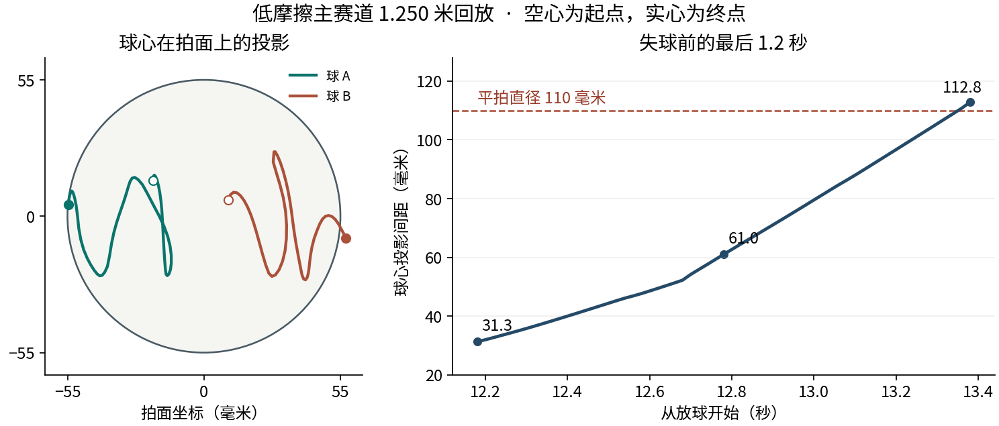

# MicroDuck 双球平拍步行与坡道停车

2026-11-28，本地 MuJoCo。MicroDuck 用嘴持 40 克平拍，同时运送两颗独立的 16 毫米球。连续赛道从放球处起算，包含 1 米平地、1 米的 1° 坡和 0.5 米平台；过线时须双球触拍，终点还须停车 1 秒。**正式连续赛道在 300 个新起点上成功 0 次，未达到 90% 目标。** [完整训练报告、流程图与复跑命令](最高滑动摩擦双球训练与验收_20261128_134441.md)

| 回放 | 看点 |
|---|---|
| [最高摩擦，独立 1° 坡上停车](slope/parked-0416-replay.mp4) | 已知开发起点，μ = 0.416。9.64 秒过一米，10.94 秒在 1.029 米处完成一秒停车。 |
| [低摩擦，正式赛道走到 1.250 米](low-route/extension-primary.mp4) | 已知开发起点，μ = 0.224。10.58 秒过一米，随后带双球上坡 0.250 米。 |
| [相同起点、相同动作，只换摩擦](media/endpoint-comparison.mp4) | 两组配对回放分别展示低摩擦、高摩擦走得更远的例子。 |
| [早期支撑相位控制对照](opening/opening-paired.mp4) | 在另一批 300 个新起点，固定 μ = 0.416 时，两秒双球触拍由 35 次增至 84 次，过一米仍为零。 |

最后 1.2 秒，两球在拍面上的投影间距从 31.3 毫米增至 112.8 毫米，超过 110 毫米的拍面直径。下图对应上表的低摩擦连续赛道视频。

## 数据与重放

- [正式验收的逐回合 CSV](qualification/blind.csv) 包含 7 组各 300 次实验。[验收协议](qualification/protocol.json)和[冻结记录](qualification/frozen.json)给出选型顺序、起点范围和校验值。
- [摩擦对照](friction/summary.json)、[收窄摩擦后的材料迁移](narrow-slope/result.json)、[等预算的两种材料训练](specialists/independent.json)和[快速向外分离的专项训练](outward/validation.json)采用各自独立的分母。
- [第 12 轮的 PPO 权重](ppo/ppo-12.npz)配合[残差控制代码](residual.py)使用。正式赛道从六个候选中选出原中档步态。[PPO 训练记录](ppo/curve.json)
- 在本目录执行 `python3 verify_evidence.py` 可核对逐回合数据、冻结文件和主报告中的 10 段视频。需要 Python 3、FFmpeg 和 ffprobe。[核验脚本](verify_evidence.py)
- [物理重放运行说明](runtime/README.md)列出历史模块、上游模型和运行环境。[历史运行包](runtime/historical-runtime.tar.gz)保留所需目录结构。[正式赛道裁判源码](../pingpong-dual16-short-20261128/short_track.py)
- 共保留 20 段 MP4 和 48 个 NPZ。5,616 条逐动作候选记录按阶段分别保存在 9 个 `candidate-branches.tar.gz` 中；在各压缩包所在目录解压即可恢复原始相对路径。

视频和轨迹来自仿真。MicroDuck 原始机器人及渲染网格由 Pollen Robotics 提供，资源归属与上游许可见[项目说明](../README.md#模型来源与许可)。
