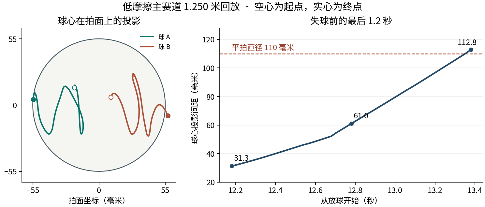
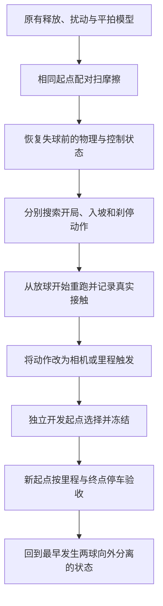

# MicroDuck 双球平拍的摩擦、开局与坡道刹停训练

本轮在本机 MuJoCo 仿真中重训了最高摩擦组，并给最低摩擦组相同的开局搜索预算。最高摩擦在已知起点做到了独立坡道一米并稳停。低摩擦在正式赛道的开发起点连续走到了 1.250 米。正式连续赛道盲测仍为 0/300，90% 的要求尚未达到。

## 怎么计分

两颗独立自由球，直径均为 16 毫米，每颗 0.432 克。球拍质量 40 克，平面半径 55 毫米；用原平面碰撞模型，未加入凹槽、定位点或额外胶皮形变。电机扭矩上限 ±0.20 N·m。物理步长 2 毫秒，控制步长 20 毫秒。延迟、释放扰动、球间碰撞、滚动和扭转摩擦沿用原模拟。本轮仅对两对球–拍接触的切向滑动系数做材料对照。所有系数均为仿真值，尚无这套球与胶皮的实物标定。

正式赛道从放球位置起算，先走 1 米平地，再走 1 米的 1° 坡，最后 0.5 米平台。过门槛时必须两个球同时触拍，全程须满足原碰撞与失球判据，终点再带球停稳 1 秒。平均里程取最后一次合法双球同时触拍的前进距离。另有整段平地、从静止出发的整段 1° 坡两个独立测试。旧纪录用固定地形网格，同一种子在该网格里从释放点到坡脚为 1.01723 米；不同赛道的回放分别计分。[赛道与逐帧裁判](../pingpong-dual16-short-20261128/short_track.py) · [球拍接触设置](material.py)

## 提高摩擦后发生了什么

在相同的 144 个新起点上重放两种控制。每个控制跑 7 个固定系数、原随机范围和高位窄带，共 2,592 个完整回合。下表为正式赛道的平均合法双球里程。置信区间以起点为单位配对重采样。

| 固定控制 | μ = 0.224 | μ = 0.320 | μ = 0.416 | 低端比高端多走的平均距离及 95% 区间 |
|---|---:|---:|---:|---:|
| 历史纪录动作 | 5.57 厘米 | 5.00 厘米 | 4.61 厘米 | 9.58 毫米（5.01 至 15.19） |
| 中档步态 | 6.38 厘米 | 6.14 厘米 | 5.78 厘米 | 5.96 毫米（1.40 至 10.78） |

最高摩擦确实减少了打滑。高摩擦时，中档控制前两秒触点平均相对滑移速度为 0.871 毫米/秒，标称摩擦时为 1.968 毫米/秒。另取 16 个新起点，对每个受力触点以 500 Hz 采样，切向力达到标量上限 μFn 的 90% 的占比，标称组为 2.45%，高摩擦组为 1.22%。这解释了为什么只加滑动摩擦收益有限：球心仍会滚向拍缘；两颗球分别往相反方向滚时，一次整体倾拍也很难同时把两球拉回中心。[摩擦档位与配对区间](friction/双球滑动摩擦扫描与接触力_20261128_133233.md) · [滑移实测](opening/excitation-validation.json) · [接触力复核](contact-load.json)

## 把高摩擦范围收窄后重新训练

固定同一个成功上坡停车的起点 14552505，外界扰动保持配对，只改变球–拍滑动摩擦。以旧停车动作为初值，在 0.414、0.4145、0.415、0.4155、0.416 五种材料上搜索 88 套动作，共 440 回合；再用四个开发材料复选。冻结后从这个窄区间独立均匀抽取 48 个材料，与旧动作逐一配对。这里的分母是摩擦系数个数，起点始终只有一个。

| 同一独立坡道起点 | 原动作 | 窄范围重训后 |
|---|---:|---:|
| 开发阶段，过坡一米并停车一秒 | 1/9 | 1/9 |
| 48 个新系数，过坡一米 | 0/48 | 0/48 |
| 48 个新系数，过坡并停车 | 0/48 | 0/48 |
| 48 个新系数，平均有效里程 | 0.520 米 | 0.520 米 |

九个开发材料中，能重现停车的都只有 0.416。收窄到宽度 0.002，再重新调动作，仍没让这套坡道停车动作可靠迁移。改善最大的一组从 0.432 米到 0.672 米，退步最大的一组从 0.852 米降到 0.455 米。[窄范围训练和配对结果](narrow-slope/固定起点窄摩擦停车迁移_20261128_135234.md)

## 哪些动作在仿真中起了作用

1. **先调开局。** 给控制器加入相机观测下的预测拍缘余量，再依据两脚高度差小幅改变步速、倾拍、颈部与偏航。在固定 μ = 0.416 的 160 个独立起点上，恰好第 2 秒双球仍同时触拍从 27 次提高至 49 次，逐起点是 23 次改善、1 次退步。通过 0.25 米从 5 次到 7 次。平均有效里程增加 5.49 毫米，95% 配对区间为 −0.19 至 11.20 毫米。在两球初始向外分离最快的 34 个起点，两套控制的两秒双触均为零。[训练、原速视频与分组审计](opening/双球支撑相位开局与滑移实测_20261128_133754.md)
2. **复用上一轮的真实状态。** 在旧纪录起点恢复同一物理状态和随机数状态，提前改变步速、倾拍与颈部。纪录材料 μ = 0.364467 时，从 1.43447 米提高到 1.44417 米，其中约 0.427 米确实在坡上。如果另外要求球心投影仍在半径 55 毫米以内，末次双触里程为 1.44080 米。固定 μ = 0.416 时，直接套旧动作只到 0.220 米；针对该材料重新搜索，8.94 秒时在 1.00024 米过线，两球心距拍心分别为 40.23、49.60 毫米。这个过线时刻仍位于固定网格的平地上。[跨材料重放](approach/material-transfer.json) · [高摩擦过线帧](approach/first-high-metre/gate-8p94.png)
3. **把坡上停车单独练。** 在 μ = 0.416 的独立 1° 坡上，开发种子 14552505 于 9.64 秒过一米，10.94 秒结束，末次双触 1.02855 米，末一秒的 50 个控制采样均双球触拍。去掉最后一段动作，仍过线但停车为零。只去掉专门的刹停，走到 1.176 米却保不住球。原动作和停车动作在同一起点配合才得到这段回放。冻结后在 128 个新坡道起点上过线、停车均为 0/128，最远 0.285 米。[成功与失败回放、消融、操作步骤](slope/高摩擦坡起步与停车训练_20261128_134242.md)
4. **用反馈学习替换记时动作。** 之前的演员网络从 23 维观测扩展到 28 维，增加分离速度、当前和预测拍缘余量、两维周期时间信号。在原步态上微调四维动作，PPO 完成 24 轮、1,152 个回合、26,403 次策略决策，第 12 轮被开发集选中。另一条路线用 168 个释放点和 185 个仍存活的中途状态学习何时切换开局动作。另以两条真实教师轨迹的 1,043 帧拟合相机反馈，固定最高摩擦的 128 个新起点上，过 0.25 米从 3 次升至 5 次，一米仍为零。[PPO 曲线](ppo/curve.json) · [冻结的演员权重](ppo/ppo-12.npz) · [开局切换参数](decisions/frozen.json) · [教师迁移逐回合](imitation/transfer.json)
5. **验证低摩擦能否直接在正式赛道过线。** 在原先预筛的 358 个自然起点比较三套开局，再从其中的合法状态做分支。μ = 0.224、种子 15387848、标准空拍静立 1.00 秒时，原动作末次双触为 0.48123 米，训练后 10.26 秒过一米，最后双触 1.23488 米，其中 0.23488 米在坡上。种子 15233602 在 10.76 秒也合法过线。另一个准备方案把放球前静立调成 1.18 秒，单独训练到 1.20348 米；冻结后移到 96 个未参与该预备方案开发、但曾按历史表现预筛的起点，训练前后均为 0/96 过米。这个 96 不并入正式盲测。[标准准备录像证据](low-route/result.json) · [预备时长试验](low-route/prep-result.json) · [96 个起点迁移](low-route/opened-transfer.json)
6. **把坡上教师的四段动作改成里程触发。** 在教师起点，使用前向里程能在相同的四个控制周期触发，重现 1.02855 米停车。192 个全新独立坡道起点上，原时序和原里程都只有 8 个起点撑到了第一段修正，两者均为 41/192 在 2 秒双触、3/192 过 0.25 米、0/192 过一米或停车。把修正提前，可触发的起点升至 18 个；相机风险版在全部 192 个起点均触发，但仅 13 个在 2 秒仍双触。到达修正时刻太晚与修正动作不适合当前两球状态，是两个可分别观察的问题。[坡道里程触发盲测](slope/observed/blind-summary.json) · [相机触发盲测](slope/observed/risk-summary.json)

## 给两种材料相同的训练预算

在连续主赛道上，低摩擦最远开发分支通过调整放球前的空拍站立时间至 1.18 秒，并尝试 1,050 个相同物理状态的后继动作，从头重放走到 **1.25006 米**。10.58 秒双球触拍过一米，随后走了 0.25006 米上坡。最后 1.2 秒，球心在拍面上的投影间距从 31.3 毫米增至 61.0 毫米，再增至 112.8 毫米，超过拍面直径 110 毫米。最后一帧即便把拍心移到两球正中，也无法把两个球心投影同时容纳在拍面内。留球控制需要在间距尚有余量时改变相对运动。最高摩擦也对两个低摩擦过线起点和一个高摩擦起点专门训练，比较 168 种起步、816 个物理分支和 324 次步速微调，正式赛道的最好开发结果为 **0.82966 米**。[低摩擦轨迹、失球几何与复跑](low-route/低摩擦连续主赛道实训_20261128_134937.md) · [最高摩擦的主赛道训练](approach/双球入坡动作分支与摩擦复验_20261128_134600.md)



高、低两组使用完全相同的 41 个开局动作、24 个初筛起点和 64 个复选起点，分别选出动作后冻结，再在另外 300 个起点上交叉测试。两组各自选出的恰好是同一套支撑相位动作（phase_24）。表中同时给出先前以两秒留球见长的 phase_08。表内用同一组新起点配对；这组种子与下节正式选型验收也互不重合。

| 固定摩擦与动作 | 2 秒双球仍触拍 | 越过 0.25 米 | 平均有效里程 | 最远有效里程 | 越过 1 米 |
|---|---:|---:|---:|---:|---:|
| 0.416，原中档 | 35/300 | 8/300 | 5.43 厘米 | 0.410 米 | 0/300 |
| 0.416，phase_08 | 84/300 | 9/300 | 6.31 厘米 | 0.440 米 | 0/300 |
| 0.416，phase_24 | 70/300 | 12/300 | 6.36 厘米 | 0.393 米 | 0/300 |
| 0.224，原中档 | 39/300 | 10/300 | 6.02 厘米 | 0.557 米 | 0/300 |
| 0.224，phase_08 | 81/300 | 12/300 | 6.70 厘米 | 0.421 米 | 0/300 |
| 0.224，phase_24 | 72/300 | 14/300 | 6.84 厘米 | 0.469 米 | 0/300 |

最高摩擦上，phase_08 的两秒留球提升在这批新起点得到了重复：50 个起点由失败转为成功，1 个由成功转为失败。0.32 下同一指标为原中档 40/300，phase_08 为 87/300。看同一动作的平均有效里程，低摩擦领先；看两秒双触，不同材料之间的排序会变。[等预算筛选协议](specialists/protocol.json) · [冻结动作](specialists/frozen.json) · [逐个起点与实际摩擦](specialists/independent.csv)

另试了 24 种通过支撑腿髋、膝、踝协调改变拍面高度的控制，限制每步的关节修正和扭矩。选出的动作在固定 0.416 的 192 个新起点上，把两秒双触由 25 提高到 36 次；过 0.25 米则由 3 次降为零，平均里程由 5.26 降至 4.27 厘米。这套动作没有进入整程主策略。[冻结腿部动作](leg-catch/frozen.json) · [两种材料的留出结果](leg-catch/heldout.json)

**速度与空拍准备时间也做了配对。** 固定 phase_08 开局，先用 24 个起点交叉比较 6 种放球前空拍静立时长和 4 种步速指令。最高摩擦时，0.33 档在 2 秒仍同触的次数较多，0.44 档有起点走过 0.25 米；0.55 和 0.65 档的每种静立时长均为 0/24 在两秒双触。步速是输入步态网络的指令，实际走速由机器人运动产生。另用 64 个起点复选，看里程时原 1 秒准备、0.44 步速入选。最好的非标准准备时间为 0.58 秒。在另一批 192 个新起点配对比较，固定 μ = 0.416 时两者均为 57/192 在两秒双触、6/192 过四分之一米、0/192 过一米。单改放球前的等待，在这组测试中没有带来稳定收益。[速度和静立时间初筛](settle-speed/screen.json) · [配对复验](settle-speed/alternative.json)

## 正式验收

事前约定在 80 个独立开发起点上，以全程停车、坡顶、平地一米、半米、四分之一米、两秒双触、平均里程的顺序选策略。六个候选在长距离均无成功，原中档步态在四分之一米及后续比较中胜出。冻结后另取相同 300 个全新起点，各赛道、各材料配对复跑。每组至少 270 次全程成功才达到经验成功率 90%。

| 冻结策略的正式测试条件 | 两秒双触 | 过四分之一米 | 最远末次双触 | 过第一米 |
|---|---:|---:|---:|---:|
| 最高摩擦，正式连续赛道 | 48/300 | 9/300 | 0.396 米 | 0/300 |
| 最高摩擦，独立平地 | 61/300 | 9/300 | 0.381 米 | 0/300 |
| 最高摩擦，独立 1° 坡 | 64/300 | 2/300 | 0.300 米 | 0/300 |
| 原宽范围，正式连续赛道 | 51/300 | 9/300 | 0.365 米 | 0/300 |
| 最低摩擦，正式连续赛道 | 47/300 | 12/300 | 0.350 米 | 0/300 |

正式连续赛道的高、原宽、低三组，2.5 米并停稳均为 0/300。单组 0/300 的二项双侧精确 95% 区间上限约 1.22%。各材料共享起点，不合并分母。[七组汇总](qualification/blind.json) · [2,100 条原始记录](qualification/blind.csv) · [冻结前选型排序及文件校验值](qualification/frozen.json)

最高摩擦正式赛道这 300 次中，244 次在放球后两秒内已经终止，终止时间的中位数为 0.94 秒。269 次由 A 或 B 越拍缘触发失球，另外 31 次为球接触拍面之外的物体。大多数回合在碰到坡脚之前就已失败。从成功坡道轨迹中直接搬用较晚的刹停动作，只覆盖得了少数起点。

针对这个失败另做了专项。用历史 768 个起点确定两球快速向外分离的阈值为 36.917 毫米/秒，在 20 个符合条件的开发起点上训练 32 种只作用于放球后前 0.5 秒的动作，另用 48 个此类起点复选。在线只用已送达的相机与身体观测，释放真值仅用于离线划分组别。在固定 μ = 0.416 的 80 个新急分离起点，新动作全部触发，末次双触平均里程从 0.77 厘米变为 1.21 厘米，两秒双触、过 0.25 米和过 1 米的次数在两套控制下均为零。另取 96 个未经条件筛选的新起点，两者均有 25 次两秒双触、4 次过 0.25 米、0 次过 1 米。提前动作已经实际试过，其增益还不足以阻止两球分开。[专项训练的固定预算和筛选依据](outward/protocol.json) · [独立配对检验](outward/validation.json)

## 看回放时观察什么

| 原速视频 | 建议看的动作 |
|---|---|
| [独立 1° 上坡并停稳](slope/parked-0416-replay.mp4) | 9.64 秒过线后，再看完整的最后一秒。 |
| [低摩擦正式赛道的最远回合](low-route/extension-primary.mp4) | 10.58 秒过一米，接着上坡 0.250 米；最后看两球朝相反的边滚去。 |
| [低摩擦在正式赛道过平地并上坡](low-route/standard-primary.mp4) | 原准备时长，10.26 秒过一米，双球随后继续上坡约 23.5 厘米。 |
| [同一坡道过线但未停稳](slope/verified-crossing-replay.mp4) | 对照能够过线却在停车时丢球的动作。 |
| [最高摩擦固定网格过平地一米](approach/first-high-metre/original-speed.mp4) | 8.94 秒看两球相对拍缘的余量。 |
| [原纪录材料的 1.444 米](approach/record/original-speed.mp4) | 在 9.64 秒过线后，观察上坡时两球逐渐分离。 |
| [开局动作逐帧对照](opening/opening-paired.mp4) | 同一新起点换动作后，第 2 秒仍能双触。 |
| [同一起点只换摩擦系数](media/endpoint-comparison.mp4) | 上排在低摩擦下走得更远，下排在高摩擦下走得更远。各取 144 个配对起点中材料作用方向相反的极端例子。 |
| [窄范围重训前后原速对照](narrow-slope/paired-comparison.mp4) | 同一开发起点与未见系数 0.415326，左侧原动作，右侧重训动作；此例为配对进步最大的一组。 |
| [坡道定时与里程触发四格对照](slope/observed/paired-extremes.mp4) | 同一组盲测中分别取改善和退步最多的起点，对照两种触发时机。 |

## 本地如何借鉴 Antigravity 做失败回放

先定位双球从分离到失球的时间窗，再恢复当时的 MuJoCo 状态、控制队列和随机数状态。每个分支只改变接下来送给步态、头颈或球拍的指令。空动作分支用来检验原轨迹能否逐步重现。保留有效分支后，还要从放球完整重跑，才计入开发里程。1.250 米主赛道回合和 1.029 米坡道停车回合均另从释放重新计算，过线时刻、末次双触里程与原记录一致。[低摩擦分支状态校验](low-route/extension-history.json) · [坡道停车重放证据](slope/parked-0416-proof.json)



## 复核与复跑

在本实验目录中执行。第一条只读汇总与视频；训练命令会重算对应结果。如需保留这一版结果，先把实验目录复制为同级新目录。

```bash
python3 verify_evidence.py
../pingpong-turn-pit-20261128/run-local friction/sweep.py
../pingpong-turn-pit-20261128/run-local opening/train_opening.py
../pingpong-turn-pit-20261128/run-local residual.py
../pingpong-turn-pit-20261128/run-local decision_policy.py
../pingpong-turn-pit-20261128/run-local matched_specialists.py
../pingpong-turn-pit-20261128/run-local leg_catch.py
../pingpong-turn-pit-20261128/run-local settle_speed.py
../pingpong-turn-pit-20261128/run-local settle_speed.py alternative
../pingpong-turn-pit-20261128/run-local outward/train.py
../pingpong-turn-pit-20261128/run-local qualify.py select
../pingpong-turn-pit-20261128/run-local qualify.py final
```

分支训练、动作时序与重渲染入口见各分项记录。策略和证据来自仿真。本实验还没有满足成功率要求的可部署整机策略。
