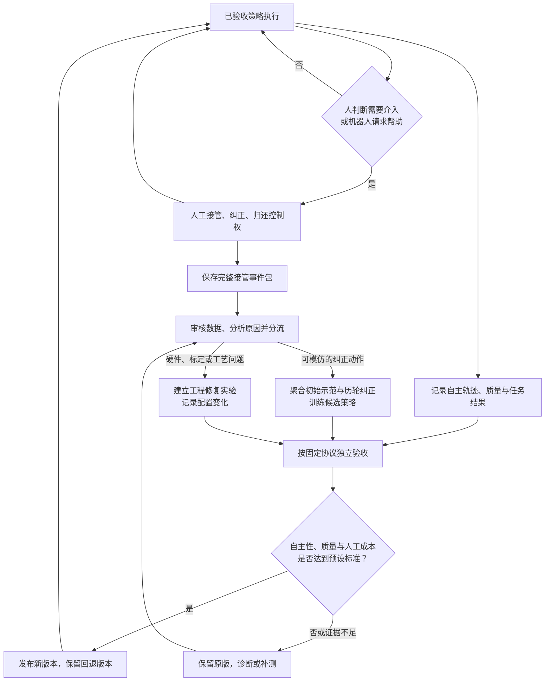

# HG-DAgger 中文调研与人工接管证据链方案

- 日期：2026-11-11（新加坡时间）。
- 文档性质：HG-DAgger 核心思路说明，以及与机器人训练 Harness、独立验收和版本管理结合的工程方案。
- 验证状态：未在本仓库执行 HG-DAgger 训练、机器人接管或新旧策略对照实验；本文不报告实测提升。

**核心目标：让每次人工帮助既能恢复当前任务，也能转化为下一轮可追溯的训练输入，并由独立评测验证是否真正减少人工依赖。**

## 1. 论文与资料入口

**论文原名：** *HG-DAgger: Interactive Imitation Learning with Human Experts*。

**中文译名：**《HG-DAgger：与人类专家交互的模仿学习》。此中文标题为本文译名。

| 资料 | 链接 | 本文使用边界 |
|---|---|---|
| HG-DAgger 论文入口 | <https://arxiv.org/abs/1810.02890> | 原始方法入口；本次环境未能取得全文，不引用未经核对的实验数值、风险估计公式或具体网络配置 |
| HG-DAgger PDF | <https://arxiv.org/pdf/1810.02890> | 实现前核对算法、采样、风险估计与评测协议 |
| DAgger 背景论文 | <https://proceedings.mlr.press/v15/ross11a.html> | 理解数据聚合与模仿学习的状态分布偏移；本次未全文复核 |
| 一份 dVRK 接管实现说明 | [固定提交的 README](https://github.com/Nicole880906/HG-DAgger/blob/83743c359c599fe88b44242c4138bfd3bf9e8d99/README.md) | 本次读取了 README；为独立项目，不视为 HG-DAgger 官方代码，也未运行或验证其训练结果 |
| 本仓库训练 Harness 方案 | [如何让一次实验的结果能成为下一次实验的输入](../如何让一次实验的结果能成为下一次实验的输入/如何让一次实验的结果能成为下一次实验的输入.zh-CN.md) | 对接任务约定、实验记忆、预算、候选评测与基线更新 |

以下公式、事件字段、数据审核和发布流程均为解释性定义或本文的工程建议，不是对原论文完整算法的逐式转录。本文将 HG-DAgger 核心思路与新增工程设计分别说明。

## 2. HG-DAgger 解决什么问题

行为克隆通常从专家示范学习“看到这种状态时应该采取什么动作”。机器人实际执行时会产生偏差，进入最初示范没有充分覆盖的状态；后续动作又可能使偏差扩大。

HG-DAgger 的核心思路是：

1. 从已有专家示范训练初始策略。
2. 让机器人执行当前策略，由人观察并决定何时接管。
3. 人在接管期间给出连续纠正动作，再归还控制权。
4. 将专家控制片段聚合到已有数据中，训练下一轮策略。
5. 重复采集与训练，使学习数据覆盖当前策略实际遇到的困难状态。

**关键价值是“在当前策略访问的状态中获得专家纠正”。** 这些数据补充了初始成功示范中缺少的恢复过程和困难场景。

HG-DAgger 中的人类门控意味着，人可以主动决定接管与归还控制权。系统也可以增加机器人请求帮助或风险提示，但不能把“机器人先请求，人才允许接管”视为核心方法的必要条件。

没有发生接管的片段，并不自动获得“动作正确”或“已证明可靠”的专家标签。

## 3. 与人工帮助证据链的结合

可以把 HG-DAgger 放在“人工纠正 → 策略学习”的内循环，把事件记录、原因分析、独立验收和版本发布放在外循环。

两者分别回答：

- **学习问题：**机器人应该从这次纠正中学到什么？
- **验证问题：**新版本是否因此更可靠、更少依赖人工？

人工把任务救回来，证明的是本次恢复成功。系统能力提升，需要由独立场景中的新旧版本对照支持。



**人工归还控制权后，继续运行当前已验收版本。** 候选训练与验收在单独流程中进行；接管不直接触发部署策略的参数替换。

图中的工程修复与策略训练应分别记录。更换夹具后表现变好，可以构成系统级改进证据，但不能全部归因于策略学习。

## 4. 一个事件包，三种数据用途

| 数据 | 主要用途 | 处理原则 |
|---|---|---|
| 接管前的观测、机器人动作与状态 | 失败分析、补充时序上下文、研究帮助触发机制 | 不将此前机器人动作自动标为专家正确动作 |
| 人工控制期间的观测与纠正动作 | 模仿学习的监督数据 | 控制权明确、动作可由机器人执行、时间对齐且质量合格 |
| 归还控制权后的自主轨迹与结果 | 判断恢复、再次失败和任务质量 | 最终成功不意味着整条轨迹都可作为专家示范 |

接管前的观测可以作为序列策略输入历史；是否对某个时间步计算专家动作损失，则由独立标签和训练掩码决定。

如果专家事后为接管前状态重新标注了合理动作，应记录这是额外的离线标注，而不是将原来的机器人动作改名为专家动作。还需确认这些状态是否提供了足够信息支持可靠标注。

人工控制也可能有误操作、延迟或无效恢复。因此，“由人控制”是来源信息，数据质量仍需审核。审核应关注时序、可执行性和动作质量，不必把整次任务最终成功作为保留每段有效纠正的唯一条件。

## 5. 接管事件包应记录什么

| 类别 | 建议字段／内容 |
|---|---|
| 身份与版本 | event_id、run_id、任务／场景身份、策略 checkpoint、软件、控制器、硬件与标定版本 |
| 触发 | 人主动接管或机器人请求；触发依据、当时任务阶段、请求时刻 |
| 控制权 | 请求、接管实际生效、归还控制权的时刻；每帧实际控制来源 |
| 连续记录 | 接管前后视频、传感器、机器人状态、指令、执行回执和缺失标记 |
| 动作语义 | 人工原始输入、映射后的机器人命令、实际应用动作、单位、坐标系与时间延迟 |
| 干预类型 | 遥操作、目标或指令修改、搬动物体、夹具调整、标定或硬件修复 |
| 恢复与质量 | 是否恢复自主执行、是否完成、质量是否合格、是否再次失败 |
| 原因假设 | 候选原因、支持证据、置信度、尚缺信息；不将症状直接当成已确认原因 |
| 数据去向 | 审核结果、排除原因、数据集版本、训练候选与关联实验 |

“记录人工输入”与“确认命令实际生效”需要分开。异步控制或动作块策略还可能存在未执行完的机器人命令；切换时应明确取消或处理这些命令，并记录过渡状态，避免把控制混合误当成人工动作。

以下 YAML 是字段示意，编号和结果均为示例，不代表本仓库已有运行数据：

```yaml
schema_version: 1
event_id: intervention_example_001
run_id: run_example_017
task_id: pick_and_place
policy_version: baseline_example_003
hardware_config_ref: configs/example_hardware.yaml
calibration_ref: calibrations/example_calibration.json

trigger:
  source: human
  reason: approach_pose_requires_correction

authority_timeline_ref: artifacts/example_authority.jsonl
observation_history_ref: artifacts/example_observations.jsonl
human_commands_ref: artifacts/example_human_commands.jsonl
applied_actions_ref: artifacts/example_applied_actions.jsonl
intervention_type: teleoperation

outcome:
  autonomous_control_resumed: true
  task_completed_with_assistance: true
  quality_passed: true

root_cause:
  hypothesis: possible_object_pose_error
  status: inconclusive

data_review:
  status: pending
  expert_label_mask_ref: null
  dataset_version: null
```

时间记录应使用可对齐的时间基准，并保留传感器时钟偏移与延迟信息。机器人请求帮助到人工实际控制之间的时间，也会影响失败程度与纠正难度。

## 6. 如何构造训练集

设第 k 轮已聚合数据为 D_k，经审核的新增专家纠正集合为 C_k，则一种说明性的更新为：

$$
D_{k+1} = D_k \cup C_k
$$

$$
C_k = \{(h_t, a_t^H) \mid \text{人工实际控制、时间对齐、标签合格}\}
$$

其中 h_t 是部署时可获得的观测历史，a_t^H 是与机器人动作空间匹配的专家命令。一个概念性的监督目标为：

$$
\theta_{k+1} = \arg\min_\theta
\mathbb{E}_{(h,a^H)\sim D_{k+1}}
\left[\ell\left(\pi_\theta(h), a^H\right)\right]
$$

损失形式取决于策略表示。上述公式不要求使用某种特定网络，也不意味着扩散策略、随机策略都应直接使用单一动作均方误差。

构造数据时应保留：

1. **初始示范与历史纠正。** 避免下一轮只剩少数失败恢复场景，损害正常任务能力。
2. **来源与采样记录。** 数据聚合不等于每帧必须等权；按事件、任务或片段采样时记录规则，并比较其影响。
3. **保持和过渡动作。** 不只抽取“人明显改变动作”的时刻，避免丢失必要的稳定保持与控制衔接。
4. **可部署输入。** 不把人工可见、机器人部署时不可获得的信息静默加入策略观测。
5. **明确的训练掩码。** 对时序策略区分上下文帧与有专家标签的动作步；有缺失、对齐问题或归属不明的动作不直接进入专家损失。

未被接纳为训练标签的事件仍保留在实验记录中，用于诊断、成本核算和失败统计。

## 7. 哪些帮助应进入其他改进流程

| 干预 | 可以形成的证据 | 下一动作 |
|---|---|---|
| 遥操作调整末端姿态并重新抓取 | 状态与专家动作对、恢复过程 | 审核后进入纠正数据集 |
| 人直接把物体放进夹爪 | 环境干预、原状态不可恢复或流程缺陷 | 分析任务与环境；不直接生成机器人动作标签 |
| 重新标定相机后恢复 | 标定版本变化及受控复测 | 建立标定修复实验 |
| 更换夹具后恢复 | 机构／工艺变化及任务结果 | 建立硬件配置实验，与策略变化分别归因 |
| 人修改任务目标或解释指令 | 意图或任务定义修正 | 更新任务／接口约定，核对新旧评价是否仍可比 |
| 日志缺失或控制权不明确 | 数据有效性问题 | 修复记录与接口，再采集 |

HG-DAgger 提供策略学习的一条路径；事件分析决定问题是否适合通过该路径处理。

## 8. 如何接入已有训练 Harness

接管采集与数据审核可以作为执行适配器和数据处理步骤接入已有 Harness，继续使用原方案的动作分类：

| Harness 动作 | 与接管数据的关系 |
|---|---|
| diagnose | 聚合接管事件，检查时序和执行证据，检验原因假设 |
| train | 为可模仿问题构造固定数据集，调用纠正数据聚合与模仿学习训练 |
| evaluate | 比较候选与已接受基线，检查自主性、质量和人工负担 |
| supplement | 样本不足、方差较大或条件覆盖不足时补测 |
| pause | 人工、机器人运行或训练预算不足，保存证据与恢复条件 |

每个候选都关联父基线、训练数据版本、代码／配置、实际训练预算和评价器版本。只有候选被接纳时，才更新已接受基线；训练失败或评测未通过也记录实际消耗。

任务目标、数据与干预策略可以讨论和改进，但不能让候选通过放宽自己的验收门槛获得接纳。更改任务分布、接管判据或硬件配置时，应显式建立协议版本。

## 9. 独立验收：如何证明人工依赖减少

接管次数下降本身不足以证明能力提升。任务变容易、操作员更晚介入、机器人更早退出，都可能产生相似数字。

| 指标 | 口径与意义 |
|---|---|
| 无人工帮助的成功率 | 成功、质量合格且全程未接受影响任务执行或结果的人工帮助的任务数／全部开始的评测任务数 |
| 任务质量与完成时间 | 防止用动作缩水、降低精度或拖延换取较少接管 |
| 每百次任务接管次数 | 接管事件数／全部开始任务数 × 100；允许一次任务多次接管 |
| 至少接管一次的任务比例 | 至少一次接管的任务数／全部开始任务数 |
| 人工控制总时长 | 同时报告总量和每次开始任务的平均值，避免只统计成功任务 |
| 持续监看、标注与审核时间 | 衡量接管之外的人工成本；接管变少不自动意味着监督人力减少 |
| 恢复后再次失败率 | 明确恢复判据、观察窗口和再次失败定义 |
| 失败、中止、数据无效及排除项 | 分别报告数量、原因与分母，不静默移除困难任务 |
| 原有能力回归 | 检查初始示范任务和既有稳定场景是否退化 |

评测中可保留保护性接管；发生接管的任务不能计为自主完成。即使没有切换控制权，人搬动物体、临时纠正目标或调整夹具等帮助也应纳入干预记录；接受帮助后完成的任务单独报告为“辅助完成”。临时更改任务目标时，还需检查是否满足原始任务，不能仅凭新目标达成就计原任务成功。人工帮助的边界在协议中预先定义，不能随版本改变。数据无效时保留原始尝试记录，说明补测规则，不将其静默计为成功或删除。

比较版本时固定或明确记录任务分布、初始条件、硬件、标定、操作员培训、干预判据和响应延迟。尽量随机安排版本执行顺序；条件允许时，避免操作员知道版本身份。

训练、开发验证与最终测试应按完整任务、场景、对象实例等适当单位划分，避免把同一次接管的相邻帧随机拆到不同集合。复测已纠正的案例可以检查问题是否修复；未见场景用于检验泛化。反复根据结果调参的开发集不能同时充当最终独立测试集。

同时报告样本量与不确定性。连续帧、同一次任务中的多个接管和重复场景通常不是相互独立样本，不能当成大量独立成功证据。

## 10. 最小对照实验

第一轮可以固定一个抓取放置任务、同一机器人与同一策略结构，设置三组：

| 组别 | 数据与训练 | 目的 |
|---|---|---|
| A：初始行为克隆 | 仅初始专家示范 | 建立未追加数据的基线 |
| B：追加完整示范 | 在相同初始数据上追加普通完整演示 | 检查增加专家数据本身的作用 |
| C：HG-DAgger 纠正聚合 | 在相同初始数据上追加策略执行中的专家纠正 | 检查针对当前策略困难状态采集数据的价值 |

B 与 C 应尽量匹配追加人工预算和训练预算，并分别记录示范、监看、接管、标注、审核、机器人运行与计算成本。无法完全匹配时如实报告，避免把更多人工或训练投入当成算法优势。

三组使用相同的保留场景与验收口径。主要比较无帮助成功率与质量，再比较达到指定表现所需的累计人工时间；同时检查原有能力回归。使用多个训练种子或重复运行时，分别记录训练变化和任务变化。

通过标准在实验开始前确定；门槛可结合任务要求设定，本文不填入未经实验支持的提升百分比。结果分为接纳、拒绝、证据不足或实验无效，并保留下一动作与原因。

## 11. 一个贯穿示例

以下为假设场景，不是实验结果：

1. 当前策略接近物体时，抓取姿态出现偏差；人主动接管。
2. 人通过遥操作调整手腕位置、重新闭合夹爪，然后归还控制权。
3. 系统保存接管前观测、控制权切换、人工指令、实际执行动作和恢复结果。
4. 审核后将有效人工片段加入纠正数据集；接管前视频用于原因分析与时序上下文。
5. “疑似物体位姿误差”保留为待检验假设，不直接写成已确认根因。
6. 固定数据版本训练候选；如果诊断发现需要修改标定，则另外建立标定实验。
7. 在保留的物体姿态与既有任务上比较新旧版本。自主成功更多、质量满足要求、人工成本下降且回归通过时，才接纳候选。

如果人只是把物体移到更容易抓的位置，本次任务仍可记录为辅助完成，但该操作不能伪装成机器人已经学会了纠正抓取姿态。

## 12. 与机器人 RSI 的关系及实施边界

HG-DAgger 更直接的定位是**人工纠正驱动的迭代模仿学习**。它依赖专家继续提供纠正，并不单独证明递归自我改进。

加入实验记忆、问题选择、候选生成、独立验收与版本管理后，它可以成为机器人 RSI 研究系统的一部分。需要分别评价纠正数据、训练方法和外层实验流程的贡献，不能将所有系统变化都归为 HG-DAgger 的原论文结论。

| 内容 | 本文定位 |
|---|---|
| 人决定何时接管与归还、收集专家动作、聚合数据并迭代训练 | HG-DAgger 核心思路 |
| 自动请求帮助、具体风险提示和阈值 | 需核对具体方法与实现；本文不声称任意风险分类器都属于原版算法 |
| 事件身份、原因假设、数据审核、硬件／标定分流 | 本文工程扩展 |
| 人工成本审计、独立保留集、发布门槛与回退 | 与 Harness 结合的工程扩展 |
| 训练效率、成功率、真实机器人表现 | 本仓库尚未实验，不给出已验证结论 |

第一版可先实现可靠记录、清晰控制权、人工数据审核、批次训练与独立验收，再研究自动风险提示。每次帮助能追溯到事件，每个候选能追溯到数据和修改，每次发布能追溯到验收结果，才构成完整的改进证据链。
