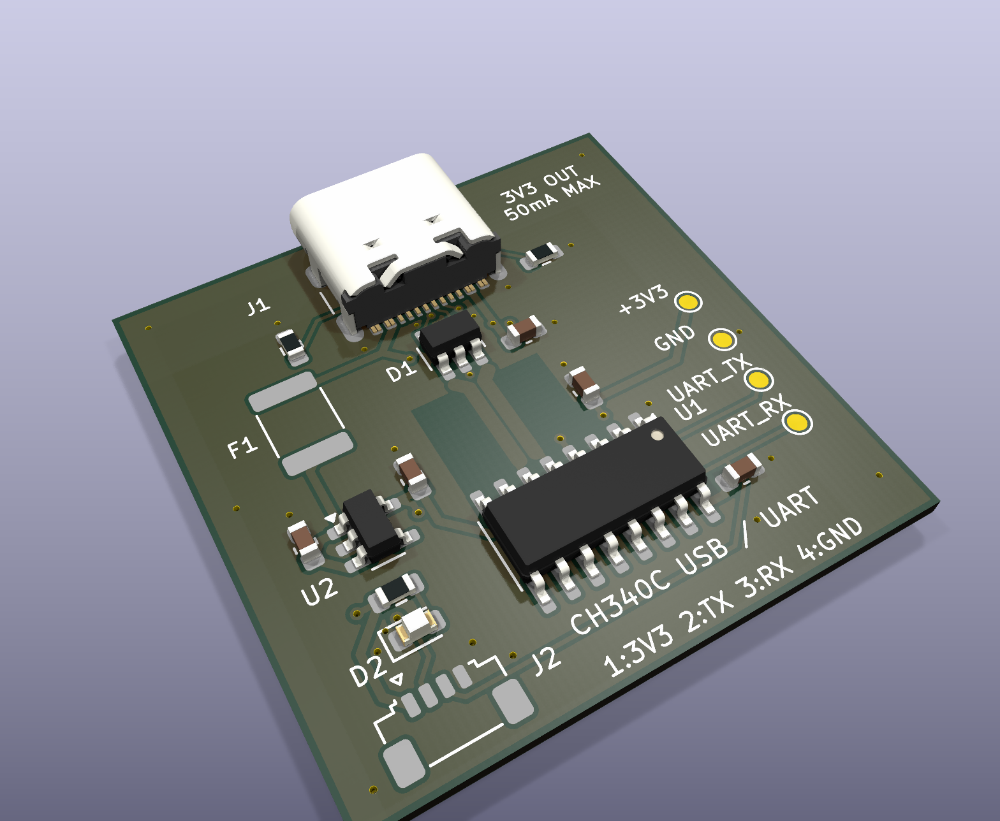

# CH340C Type-C 转 3.3V TTL 转接板

30×30mm、双层、成品板厚 1.0mm、全部元件在顶面，普通自由走线使用斜线／45°转角。使用 CH340C 内部时钟，USB 5V 经 AP2112K 稳压为 3.3V。

TTL 使用 JST SUR 0.8mm 四针卧插连接器，焊盘编号依次为 **1＝3.3V、2＝TX、3＝RX、4＝GND**。TX／RX 以本板方向命名；连接目标时交叉接线。

## 下载与查看

- [完整 KiCad 9 工程 ZIP](CH340C_USB_TTL_30x30_RevA.zip?raw=true)：含可编辑工程、制造输出、BOM、模型、分析记录及说明。
- [工程目录](ch340-usb-ttl/)／[使用说明](ch340-usb-ttl/README.zh-CN.md)。
- [原理图 PDF](ch340-usb-ttl/exports/ch340-usb-ttl-schematic.pdf)。
- [Gerber 与钻孔 ZIP](ch340-usb-ttl/exports/CH340C_USB_TTL_RevA_Gerber.zip?raw=true)。
- [BOM](ch340-usb-ttl/BOM.csv)／[顶层贴片坐标](ch340-usb-ttl/exports/ch340-usb-ttl-top-pos.csv)。
- [设计审查](ch340-usb-ttl/REVIEW.zh-CN.md)／[制板要求](ch340-usb-ttl/FABRICATION.zh-CN.md)／[首板测试](ch340-usb-ttl/BRINGUP.zh-CN.md)。

解压完整工程，使用 KiCad 9 打开 `ch340-usb-ttl.kicad_pro`；保留同目录的本地符号和 `3dmodels/`。

预览已包含取得的 7 类官方 KiCad 模型；JST 卧插连接器与 PTC 的精确模型缺失，不能据此检查它们的机械干涉。

## 验证与制造条件

原生 ERC／DRC、未连接及原理图／PCB 一致性检查均为 0。USB 均匀差分干线按 90Ω 目标设计，名义计算约 89.859Ω；焊盘、换向分支和窄线过渡另计。投板前须由板厂按实际叠层确认阻抗，并核对所采购连接器的厂家尺寸图。

3.3V 外供预算建议不超过 50mA；此数值不是独立电子限流器。尚未进行实物枚举、回环、负载、EMC／ESD 或阻抗测量。完整边界见设计审查和使用说明。

第三方模型、计算代码及数据手册的来源和许可保存在工程内的 `NOTICE.md`、`3dmodels/`、`references/` 与 `datasheets/`。
