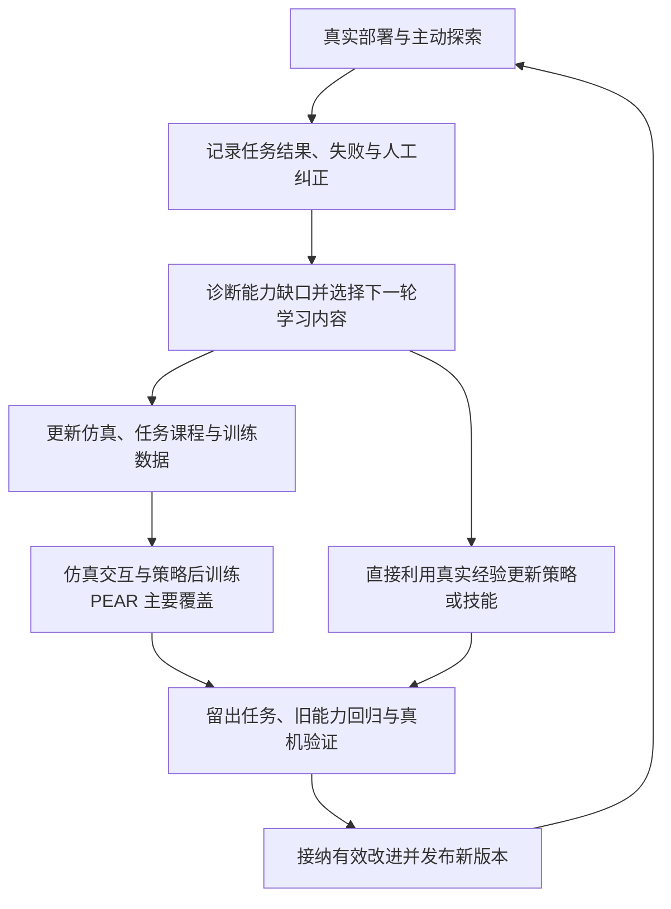

# PEAR 与 Robot RSI 中文技术调研

调研日期：2026-11-16（新加坡时间）。对象为 MIT 韩松团队等发布的 PEAR，以及它对机器人递归自我改进研究的意义。

**结论：PEAR 展示了通用推理模型通过纯仿真强化学习获得机器人操作能力，并将部分能力迁移到真实机器人的可行性。它主要覆盖完整学习系统中的仿真策略训练内循环，尚未展示真实部署反馈驱动的持续改进外循环。更值得研究的组合是：真实反馈驱动方向，仿真扩大练习量，批量训练与验证把改进稳定地部署出去。**

下文区分作者实验、根据公开数字的估算，以及对 Robot RSI 的研究判断。实验成绩主要来自作者报告；本次没有运行训练、下载验证模型权重或进行真机复现。对未来路线的判断不等同于已经确立的行业共识。

## 1. 项目定位与资料

- 论文：**Training Reasoning Models in Simulation to Natively Use Real Robots**，预印本日期为 2026-11-14。[S1]
- PEAR 全称：**Post-training Engine for Agentic Robotics**，是机器人智能体后训练基础设施。[S2, S3]
- 训练方法：Robot-Use Reinforcement Learning，简称 RURL。
- 基础模型：Qwen3.8-27B；本文中的 PEAR 模型指经过该流程训练的派生策略，不是从零预训练的新基础模型。
- 官方代码：[mit-han-lab/pear](https://github.com/mit-han-lab/pear)。本次检视版本：`f32aa1f7c2ec9c3f45630cc9f8541b3201e8e087`。
- 官方提供权重入口：[PEAR 模型集合](https://huggingface.co/collections/mit-han-lab/pear)。具体权重分片和模型许可证正文未在本次独立验证；代码仓库标注 Apache-2.0，不能据此推定所有权重与资产采用相同许可。[S3]

## 2. 操作机制与训练流程

### 2.1 从观察到动作

模型反复执行以下循环：[S1, S2]

**相机图像与机器人状态 → 语言推理 → JSON 位姿变化 → 逆运动学与控制器执行 → 新画面与状态反馈。**

动作接口表示末端执行器位置、姿态及夹爪等量的变化，位置和角度使用厘米、弧度等约定。模型不直接输出电机电流。机器人坐标系、相机和本体描述进入提示；逆运动学与底层控制器负责实际到位。

系统不向模型提供独立的感知工具、抓取规划器或高层技能库，因此模型需要从图像与历史中判断目标、选择下一步并处理执行偏差。“没有这些工具”不等于没有机器人标定、控制实现和适配工程。

### 2.2 分阶段强化学习

本次机器人后训练不使用人类遥操作演示或真机训练数据，而是利用仿真任务是否成功的反馈更新策略。这个范围限定在该后训练流程，不能据此证明基础模型预训练从未接触相关机器人知识。[S1, S2]

| 阶段 | 主要训练内容 | 对应结果与使用边界 |
|---|---|---|
| 第一阶段 | LIBERO Goal、Spatial、Object | 未训练 Long 时，Long 成功率达到 39.0% |
| 第二阶段 | 四套 LIBERO | LIBERO-only 检查点总体成功率 74.4% |
| 第三阶段 | 在前述基础上加入 RoboDojo 的 general_pickup 与 align_blocks | 最终模型用于真机 18/30 和 RoboLab 37.3% 等实验 |

课程、奖励和优化流程由研究者设计。能够从自身 rollout 学习，说明存在策略参数优化；不自动证明系统改善了自身的学习方法。[S1, S4]

## 3. 主要实验结果与报道纠正

### 3.1 LIBERO 的闭源模型成绩被报道对调

以下为作者报告的成功率。不同设置的推理预算没有统一，PEAR 已在 LIBERO 上训练，不能据此推定通用智能水平接近闭源旗舰。[S1，图 3 与附录表 2]

| 模型与设置 | LIBERO 成功率 |
|---|---:|
| Qwen3.8-27B，训练前 | 1.6% |
| PEAR，LIBERO-only，xhigh | 74.4% |
| GPT-6.1 Sol，max | 76.2% |
| GPT-6 Astra，max | 80.6% |
| π0.5，LIBERO 专项微调 | 96.9% |

用户提供的报道把 Sol 与 Astra 的 max 成绩对调了。PEAR 与 Sol 相差 1.8 个百分点，与 Astra 相差 6.2 个百分点。

### 3.2 对任务与布局变化更稳健

| LIBERO-Pro 扰动 | π0.5 | PEAR LIBERO-only |
|---|---:|---:|
| 更换任务目标 | 0.75% | 57.4% |
| 更换物体位置 | 20.8% | 57.5% |
| 改写指令措辞 | 95.8% | 73.3% |
| 改变物体外观 | 96.0% | 60.2% |
| 四类扰动均值 | 53.3% | 62.1% |

这些结果支持“本实验中，PEAR 对新目标和新布局更稳健”。π0.5 的数值来自既有公开结果，底座、数据、优化方法、动作表示与推理计算也未全部控制，因此不能把差异严格归因为“推理对模仿”或“RL 对 SFT”。[S1，附录表 3]

π0.5 本身通过多机器人、网络数据和高层语义预测研究开放环境泛化。特定 LIBERO 微调策略的退化，不能外推为 VLA 永远无法泛化。[S12]

### 3.3 跨基准结果有明确范围

最终模型在 RoboLab-120 上报告 37.3%，接近论文选取的 Cosmos3-Nano-Policy 36.8%。这不是当前完整榜单的最优成绩；调研时官方榜单还列有 AMP1、SenseNova-RoboRSI 等更高成绩系统。不同系统的数据、输入与执行架构也需要核对。[S1, S8]

在完整 RoboDojo 测试中，最终模型成功 **21/540 次**；按照官方五类能力分别计算后取平均的口径，得分为 **5.50%**。这两个数字不是同一统计量。**370/540 次，即 68.5%，因上下文耗尽而失败。**这限制了从两项训练任务向广泛长程能力的外推。[S1，附录 E]

### 3.4 通用能力保留的准确表述

九项通用评测的均值为 81.64 → 81.49；各项配对 95% 区间均包含零变化。适合表述为“这些评测未检测到显著退化”，不能证明所有能力都完全不遗忘。[S1，附录 F]

## 4. 真机迁移与泛化边界

作者在双臂 YAM 上对每个模型进行 30 次测试：20 次物体抓取、10 次利用三角尺排列积木。[S1，附录 G]

| 模型 | 抓取 | 排列积木 | 合计 |
|---|---:|---:|---:|
| 基础模型 | 0/20 | 0/10 | 0/30 |
| LIBERO-only | 6/20 | 1/10 | 7/30 |
| 最终模型 | 12/20 | 6/10 | 18/30 |

最终模型在 RoboDojo 仿真中训练过这两类任务；新的是 YAM 本体与真实环境。因此 60% 主要支持跨机器人与仿真到真实的迁移，不能视为任意新真实任务的成功率。

画画与化学实验属于另外的定性演示，未提供系统成功率；作者也说明较难演示依赖详细的机器人与任务提示。[S1, S2]

## 5. 单卡推理与训练成本

### 5.1 221 token/s 与准确率来自不同精度条件

RTX 5090 的 221 token/s 使用 **NVFP4 量化、DFlash2 推测解码与专用 megakernel**；论文准确率评测使用 **BF16**。作者明确指出 NVFP4 会降低准确率并延长思维链。因此不能将 74.4% 或真机 60% 视为 5090 以该速度运行时已经验证的成功率。[S1，第 4.6 节；S2]

按 BF16 评测中 xhigh 平均每轮约 3,230 个思考 token 与 221 token/s 作条件估算：

```text
思考解码时间 ≈ 3230 / 221 ≈ 14.6 秒每轮
```

这是根据公开数字的粗略估算，不是真机实测；未计入图像处理、输入预填充、动作输出和机械运动，量化还可能改变推理长度。token/s 不能直接换算为动作控制频率。

low 档的 LIBERO 成功率为 21.9%，xhigh 为 74.4%。缩短推理与保持成功率之间仍存在明显权衡。[S1, S2]

### 5.2 部署工程与训练资源

- 官方部署文档支持 YAM 与 SO-101；5090 配置使用 NVFP4，GB300 可使用 BF16 或 NVFP4。[S5]
- 5090 配置针对 32GB 显存，采用 FP8 KV 缓存，并将 embedding 与视觉编码器放到主机内存。因此性能还依赖整机内存和运行配置。[S6]
- 论文披露总训练约 **50,000 H100 等效 GPU 小时**。训练配方使用 32 节点集群，不能由单卡可推理推断单卡可经济复训。[S1，附录 A；S4]
- 部分 RoboDojo、RoboLab 的额外环境配置指南仍待补充。代码公开与完整环境一键复现需要分别核查。[S7]

## 6. Robot RSI 中的三个改进层次

本文将 Robot RSI 理解为机器人递归自我改进。需要同时区分经验来源与学习阶段：**sim / real 描述经验来自哪里，pre-training / post-training 描述学习发生在哪个阶段。真实交互数据同样可以用于后训练。**

| 层次 | 改变什么 | 需要什么证据 |
|---|---|---|
| 任务内反馈纠错 | 根据本轮新观察调整动作或计划 | 当前任务中的恢复与完成情况 |
| 持久策略或技能学习 | 保存经验并更新权重、记忆或可复用技能 | 后续独立任务表现持续改善 |
| 改善学习过程本身 | 改进任务选择、诊断、数据生成或训练流程 | 同等总预算下，后续学习优于固定改进流程 |

PEAR 提供了仿真交互训练与部分迁移证据，未展示完整真实反馈外循环或隔离出的递归增益。部署时根据画面纠错，也不等于这段经验已经被保存并用于下一次训练。[S1]

更严格意义的 RSI 关注“系统是否越来越会改进自己”。相关综述也指出，现有物理研究对递归本身带来的额外收益仍缺少充分隔离验证。[S11]

## 7. 真实反馈与仿真训练的完整闭环

以下是用于研究规划的分析框架，**不是 PEAR 当前已经实现的功能清单**。



真实环境可以暴露接触、摩擦、柔性物体、时序和传感器漂移等训练缺口；这些反馈既可以直接用于学习，也可以指导仿真校准和针对性练习。仿真承担可重复、可扩展的练习，真实验证检验改进是否兑现。

相邻研究提供了两类实例：RECAP / π*0.6 利用真实机器人自主经验与人工纠正改善策略；EmbodiRSI 根据目标部署场景构建仿真，并用执行反馈指导后续经验获取与策略更新。它们支持混合闭环值得探索，不能据此宣称任何完整路线已经解决。[S9, S10]

## 8. 从 PEAR 得到的四点研究判断

### 8.1 仿真可以成为有效的能力启动器

强底座模型能利用仿真交互获得操作能力，减少初始阶段对真机演示的依赖。这为完整系统提供一种训练模块，但仿真启动后的持续改进仍需要检验真实效果。

### 8.2 真实反馈可以决定仿真该练什么

反馈的价值不仅在于给策略更多训练样本，还在于改变下一轮任务分布。应根据可核查的失败证据，判断需要调整策略、补充观察、修正控制接口，还是校准仿真。仅凭一次失败就指定物理原因，可能把错误诊断放大成大量无效练习。

### 8.3 成功率提升还要转化成可用的执行效率

长推理、任务复位、故障恢复和人工干预都影响持续改进的成本。仿真分数上升后，还要观察任务完成时间、每小时可靠完成量和接管需求是否改善。

### 8.4 真实反馈驱动方向 仿真扩大练习量

未来一段时期值得关注的组合是：**真实反馈驱动方向，仿真扩大练习量，批量训练与验证负责把改进稳定地部署出去。**这是研究判断，尚不足以确定不同路线将占据多少训练量或市场份额。

该组合不要求每台机器人现场持续更新权重。反馈可以汇总到车队或训练中心，通过批量训练、技能更新或仿真校准产生候选，再经过验证周期性部署。

PEAR 没有覆盖完整系统，不妨碍其训练内循环成为重要组成部分；“不完整”不能直接推出“不会成为主流模块”。

## 9. 核心研究问题 从一次失败到一类失败的改进

**如何把一次昂贵的真实失败，转化为能够消除一类失败的训练增量？**

最关键的连接环节是“失败 → 学习任务”。一个可检验的过程包括：

1. **保存可复查证据。**记录模型与配置版本、指令、观察、动作、实际执行结果及终局状态，区分策略失败与数据或执行接口故障。
2. **提出并检验原因。**把“抓取后掉落”等现象与“摩擦不足”等候选解释分开，通过测量或受控对比缩小原因范围。
3. **选择改进载体。**决定使用真机纠正数据、针对性仿真、任务课程、感知或控制修复，或者可复用技能。
4. **生成相关但有变化的练习。**覆盖相同失败机制下的物体、布局与参数变化；对未确认的物理参数保留不确定性。
5. **训练并独立验证。**验证原问题、未见变体与旧能力，不让候选通过改变成功判据获得接纳。
6. **保存净收益与适用范围。**记录哪些变化有效、代价多少、在哪些条件下仍失败，作为下一轮任务选择的输入。

例如，针对“抓取后物体滑落”，可以检验摩擦、夹持姿态、抓取位置和执行时序等解释，再决定补充哪种数据。这个例子是研究设想，不是 PEAR 已披露的自动诊断功能。

## 10. 学习效率与运行效率

这两类效率回答不同问题，需要分别报告。

| 维度 | 核心问题 | 可观察指标 |
|---|---|---|
| 学习效率 | 花多少资源，获得多少可迁移的能力净提升 | 留出任务学习曲线；真实机器人小时；人工分钟；仿真交互量；GPU 时间；数据与验证成本 |
| 运行效率 | 改进后能多快、多稳定地完成工作 | 每小时可靠完成量；端到端任务时间；复位时间；接管次数；故障恢复时间 |

能力提升应在固定的留出任务和评价标准上计算，并检查旧能力回归。机器人小时、人工分钟和 GPU 小时不能直接相加为一个无单位分母；可分别报告学习曲线，或在明确价格与资源假设后计算总成本。

若要进一步检验 RSI，可比较固定任务采样、等量随机补数据与真实失败驱动的自适应采样，在匹配真实交互、仿真交互、模型计算和评测预算的条件下，观察多轮学习差异。只有训练量更多而没有预算匹配，不能证明学习机制本身更有效。

需要重点检验的假设是：**系统通过经验，越来越会选择下一轮该学什么、怎样学，从而提高后续学习效率。**这比单次模型发布的 benchmark 提升更接近更强意义的 RSI。

## 11. 与仓库其他研究的联系

- [CaPtain 与 Physical Critic 中文调研](../captain-research/captain-research.zh-CN.md)：补充请求级信用分配、参数学习与更严格 RSI 检验的讨论。与 PEAR 的模型、工具和评测协议不同，不直接比较分数。
- [如何让一次实验的结果能成为下一次实验的输入](../如何让一次实验的结果能成为下一次实验的输入/如何让一次实验的结果能成为下一次实验的输入.zh-CN.md)：提供实验状态、证据记录、预算、固定评价器和候选接纳的训练 Harness 设计；可作为本文外循环研究的实现参考。
- [HG-DAgger 中文调研](../hg-dagger-research/hg-dagger-research.zh-CN.md)：连接人工干预与反馈数据研究，帮助分析真机经验如何进入后续学习。

## 12. 证据索引

PEAR 代码与文档链接固定到本次检视版本；论文、博客与榜单按调研日期读取。文中的未来路线、闭环架构与实验建议为研究分析。

- **S1 PEAR 原论文与附录**：[Training Reasoning Models in Simulation to Natively Use Real Robots](https://mit-han-lab.github.io/pear-blog/paper.pdf)。重点为第 4 节、限制讨论与附录 A、E、F、G。
- **S2 官方技术博客**：[PEAR Blog](https://mit-han-lab.github.io/pear-blog/)。支持操作机制、推理量与速度条件、提示依赖及当前限制。
- **S3 项目说明**：[PEAR README](https://github.com/mit-han-lab/pear/blob/f32aa1f7c2ec9c3f45630cc9f8541b3201e8e087/README.md)。支持基础设施定位、环境与部署组件说明。
- **S4 训练配方**：[train/README.md](https://github.com/mit-han-lab/pear/blob/f32aa1f7c2ec9c3f45630cc9f8541b3201e8e087/examples/models/qwen3_8_27b_pear/train/README.md)。支持分阶段训练与参考集群配置。
- **S5 部署文档**：[deploy/README.md](https://github.com/mit-han-lab/pear/blob/f32aa1f7c2ec9c3f45630cc9f8541b3201e8e087/examples/models/qwen3_8_27b_pear/deploy/README.md)。支持 YAM、SO-101 与各 GPU 精度配置。
- **S6 RTX 5090 配置**：[rtx5090.yaml](https://github.com/mit-han-lab/pear/blob/f32aa1f7c2ec9c3f45630cc9f8541b3201e8e087/examples/models/qwen3_8_27b_pear/deploy/gpu/rtx5090.yaml)。支持显存、KV 缓存和主机内存安排。
- **S7 安装文档**：[installation.md](https://github.com/mit-han-lab/pear/blob/f32aa1f7c2ec9c3f45630cc9f8541b3201e8e087/docs/getting_started/installation.md)。支持环境依赖与尚待补充的设置说明。
- **S8 RoboLab 官方榜单**：[RoboLab Leaderboard](https://research.nvidia.com/labs/srl/projects/robolab/leaderboard.html)。榜单会更新，不能把论文选取的基线视为完整排行榜。
- **S9 真实经验与纠正数据学习**：[π*0.6 与 RECAP 官方介绍](https://www.pi.website/blog/pistar06)。支持利用自主经验和人工纠正更新真实机器人策略的路线。
- **S10 真实到仿真再到真实的适应**：[EmbodiRSI，arXiv v4](https://arxiv.org/abs/2609.38905v4)。支持部署场景构建仿真、反馈指导经验获取与策略更新的研究实例。
- **S11 物理系统 RSI 的概念与评测边界**：[Toward Recursive Self-Improvement in Physical AI，arXiv v1](https://arxiv.org/abs/2610.29677v1)。支持区分行为改进与改进过程的改进。
- **S12 VLA 泛化研究背景**：[π0.5 官方研究介绍](https://www.pi.website/blog/pi05)、[π0.5 原论文](https://arxiv.org/abs/2504.16054)。支持多源联合训练、高层语义决策与开放环境泛化的背景。
