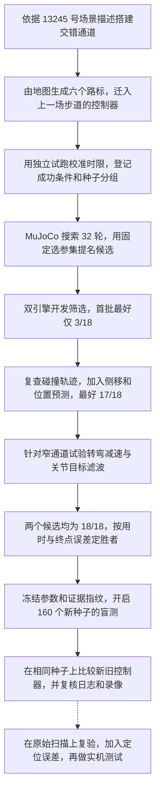

# MicroDuck 在电子维修店交错通道中的训练与双引擎盲测

沿用同一份 14 关节步态网络 `alpha_walking.onnx`，只调整上层路线跟踪和关节目标处理，MicroDuck 在 160 个盲测种子上的**双引擎联合完成数由 0/160 提高到 160/160**。最关键的诊断来自第 16 轮候选。它在 MuJoCo 的 18 个开发样本上全部通过，换到原生 CPU PhysX，同批样本只通过 2 个。这促使开发从调整前进和转向增益，转向直接控制绕柜时的横向运动。

## 场景与验收任务

Ropedia Xperience 2 的 13245 号场景（ID `2097210255143030786`）记录了商场电子维修店门外的瓷砖通道、玻璃柜台和金属丝陈列架。选择它，是为了在较短距离内连续改变绕行方向，让转身过慢、横移不足和停车过晚都能在一回合中显现。实验取得了官方场景描述，原始 OBJ 下载收到 0 字节。三处障碍的位置、开口宽度和地面摩擦由实验设定，四种布局都是这个场景的简化模型。场景资料由 Ropedia Research Team 以 CC BY-NC 4.0 发布。[官方数据卡](https://huggingface.co/datasets/ropedia-ai/Ropedia-Xperience-2) · [仓库中的数据集介绍](https://github.com/ReadbytheBeach/robot-rsi-research/blob/main/ropedia-xperience-2/ropedia-xperience-2.zh-CN.md)

起点到终点直线距离为 2.15 m。规划程序从地图中找到每道障碍旁的空隙，两侧各留 7.5 cm 余量，在空隙中线的入口和出口各设一个路标。三道障碍共六个路标，得到约 2.42–2.57 m 的参考路线。在同一布局中，所有候选沿相同路线行走，并读取仿真位姿。L0、L1、L2 三个开发布局的开口宽度分别为 47.5、43、39 cm。留出布局 L3 的三个开口分别为 38.2、43.5、41 cm。L3 的几何在实验登记时已知，首次运行 L3 回合是在控制器冻结之后。

| 事先约定的项目 | 判定方式 |
|---|---|
| 一次任务成功 | 15 秒内依次进入六个路标各自的 9 cm 半径，净前进至少 1.99 m。发出零速度指令后，在终点 10 cm 内连续驻留 0.50 秒。 |
| 一次任务失败 | 接触柜架或墙、非足部触地、躯干低于 7.5 cm、倾斜超过 55°，或到时仍未完成任务。 |
| 联合完成 | 同一随机种子在 MuJoCo 和原生 CPU PhysX 各运行一次，两者均成功才计一次联合完成。种子决定起始位置和朝向、摩擦及伺服参数等扰动，执行器额外延迟分 0 和 20 ms 两档。 |
| 盲测门槛 | 总体联合完成率至少 90%，每个“布局 × 延迟”组至少 80%。 |

## 开发与验收流程

### 从失败轨迹到冻结配置

| 阶段 | 做了什么 | 哪条证据决定了下一步 |
|---|---|---|
| 迁移与长训练 | 以上一场有顶步道冻结的控制器为基线。固定底层 ONNX，搜索速度上限、转向增益、接近路标增益、动作幅度与刹停半径。每轮 12 套参数共享 6 个新种子，先比最弱组，再比总成功数和代价，前三名更新下一轮采样分布。 | 32 轮共 2,304 个训练回合，其中 1,952 次成功、332 次超时、20 次碰撞，累计 7.71 个仿真小时。另有 594 次选参评估，来自反复使用的 18 个固定种子。 |
| 跨引擎找失败 | 8 个候选分别接受同一批 18 个双引擎开发种子的检查。 | 首批最好仅联合通过 3/18。PhysX 一次诊断中，机器人通过第三个路标后头壳碰到右墙。仅控制前进和偏航时，它能朝向下一个路标，却来不及横向让开柜架。 |
| 修正横向运动 | 将路标误差分解到机身的前后和左右方向，分别控制前进、侧移。用位姿变化估计速度，预测短时间后的位置，并调节机身朝向。先在窄通道试 30 套侧移参数，再比较候选间的 11 档插值。 | 最好的侧移版双引擎开发成绩达到 17/18，但最窄的 L2 零额外延迟组仍只有 2/3，需要单独复测。 |
| 修正转弯节奏 | 横移需求较大时降低前进速度，并混合本拍和前一拍的原始关节目标。先筛 12 套变体，再对 6 套候选做 11 种子复测，其中 5 个专用于 L2 零延迟。 | 4 套通过全部 11 例。减速最强的两个变体在 MuJoCo 的 5 个窄通道零延迟样本上全部超时。最终入围的两套在统一开发集上都达到联合 18/18，每组均为 3/3。 |
| 冻结后再盲测 | 按预先约定的用时和终点误差代价打破平局，1.1637 优于 1.2652。于新加坡时间 2026-11-18 21:42:31 冻结 `f_mix09_80_40`，随后开启留出种子。 | 获选配置限速 0.538 m/s，位置预测提前 0.12 s，横移需求最大时前进指令降低 40%，关节目标取本拍原始目标的 20% 和上一拍原始目标的 80%。复现行为需要对应控制代码、冻结参数和原步态 ONNX。 |

## 冻结后的成绩

4 种布局 × 2 档延迟 × 每组 20 个新种子，共 160 个配对试样。每个种子分别跑新旧控制器和两个引擎，共 640 个计分回合。

| 控制器 | MuJoCo 完成 | PhysX 完成 | 两引擎均完成 |
|---|---:|---:|---:|
| 从有顶步道迁入的基线 | 56/160 | 0/160 | 0/160 |
| 冻结的新版 | 160/160 | 160/160 | **160/160** |

新版八组均为 20/20，其中留出布局 L3 合计 40/40。两个引擎平均用时分别为 10.59 s 和 11.17 s，平均终点误差分别为 5.01 cm 和 4.29 cm。联合完成率的名义 Wilson 95% 区间为 97.66%–100%，单组 20/20 的区间为 83.89%–100%。基线在 PhysX 的 160 次失败由 143 次任务超时和 17 次障碍接触组成。

**同一个种子可以看出改动发生在哪里。** 在预先指定录像的 L3 零延迟种子 42223 上，旧版在 PhysX 走过三个路标后超时，距终点 87.11 cm。新版走过六个路标并完成驻留，用时 12.06 s，误差 5.44 cm。在 MuJoCo，旧版已走过六个路标，但到时仍距终点 13.57 cm，新版用时 10.80 s，误差 5.68 cm。

**成功率与停车精度有取舍。** 在新旧两版都成功的同一批 56 个 MuJoCo 种子上，平均用时从 14.62 s 缩短到 10.15 s，平均终点误差从 1.73 cm 增到 4.35 cm。两版使用相同的 10 cm 验收半径。新版把发出停车指令的半径从 3.50 cm 放宽到了 8.45 cm。

## 证据与适用范围

独立复跑重现了 2,304 条训练结果和 594 条选参结果。验收时回放了全部 320 个 MuJoCo 盲测回合，并核对了 320 个 PhysX 回合记录。PhysX 有 5 次进程超过宿主机运行时限，按原种子、原参数重试，每个样本仅计分一次。这与机器人在仿真内超过 15 秒任务时限分别计数。

以下是完整实验在开发工作区中的归档位置。实验目录为 `experiments/ropedia-slalom/`。其中 `protocol.json` 记录验收规则，`runs/frozen.json` 记录获选参数和选优证据指纹，`runs/blind-results.json` 保存配对成绩，`verification.json` 保存核验结果。`video/05-physx-holdout-comparison.mp4` 是种子 42223 的 PhysX 新旧轨迹同步录像。配对成绩文件的 SHA-256 为 `ad578b412b04a0600c6bfa352f5840c81f259d9c30f50051a780923663e0e893`，可用于核对取得的归档副本。

这次验收覆盖四种已知地图和已登记的扰动范围，机器人直接读取仿真位姿。实机试验次数为零。将结果推广到真实店面还需依次验证原始扫描几何、带定位误差的路线跟踪，以及实机在相同绕行与驻留条件下的完成率。
