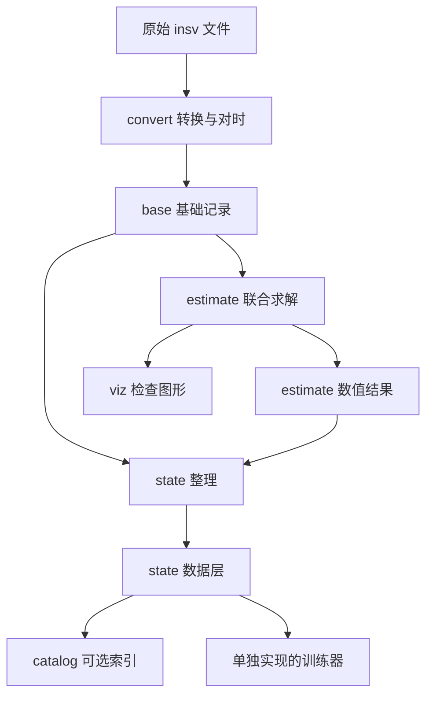
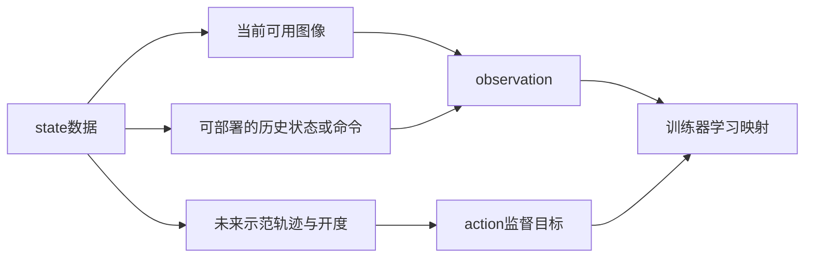

# Specialist 数据重建 README 导读：管线、数据层与训练样本

- 日期：2026-11-10（新加坡时间）。
- 来源版本：官方 `specialist` 提交 `da29719cdbaa366df0599984068ad4553d9cc86d`。
- 阅读对象：希望理解 `.insv → base → estimate → state → 训练数据` 的读者。
- 验证边界：结合 README 与对应源码解释；没有真实录制数据，未执行官方 CUDA 重建、Rerun 真实文件读取或行为克隆训练。文中数值例子均为教学示意。

主文档：[Specialist Gripper 中文调研](specialist-research.zh-CN.md)。原文：[数据重建 README](https://github.com/specialist-ai/specialist/blob/da29719cdbaa366df0599984068ad4553d9cc86d/README.md)。

## 1. 这个仓库到底做什么

它把相机记录的传感器数据，转换成能用于操作学习的运动记录。

假设人用手持夹爪拿起杯子，相机拍到了全过程。机器人学习时还需要知道：夹爪在每个时刻的位置、朝向与开度，以及接下来怎样移动。

`specialist` 仓库提供转换、对时、运动重建及状态整理。它不是把视频直接送进网络就训练出策略的完整训练仓库；README 中的 `obs/action` 图说明训练器应如何使用输出，不表示 `state.py` 已经实现策略训练。

可以把数据层理解为：

| 数据层 | 回答的问题 | 类比 |
|---|---|---|
| 原始 `.insv` | 设备最初记录了什么 | 原始素材 |
| `base` | 传感器数据怎样统一解读、对时 | 整理后的证据 |
| `estimate` | 根据证据推断运动是什么 | 求解结果 |
| `viz` | 怎样把结果画给人检查 | 检查视图 |
| `state_s8_r100` | 怎样提供一致的数据接口 | 训练数据基础层 |
| `assets` | 使用了哪个夹爪模型 | 静态几何与坐标树 |
| `catalog` | 怎样统一检索多次录制 | 数据服务与索引 |

这几层的职责不同。修改可视化布局不应改变动作标签，重跑求解也不应覆盖采集证据。



注意 `state` 同时依赖 base 与 estimate；它不从 viz 的轨迹线反推标签。

## 2. 三个概念：capture、session、layer

### 2.1 Capture：一台相机的一次录制

一台相机的一次 capture 包含对应的 `.insv` 文件对。双镜头相机不等于两个独立夹爪。

双手采集通常有两个 capture，每个 capture 对应一台相机。转换命令给每台相机传入 `_00_` 主文件，程序寻找对应 `_10_` 文件。

### 2.2 Session：一组同时发生的采集

一个 session 把参与同一次操作的 capture 组织起来。转换后，左右相机的时间对齐到共同会话时钟。

session ID 来自第一份 capture 的开始时间与相机序列号。它也是各动态数据层使用的 Rerun recording ID，用于把同一次采集的不同层联系起来。

不同 session 的世界参考与时间原点可能不同，不能仅因为 `row=2000` 相同就把两次录制拼成一条连续运动。

### 2.3 Layer：同一个 session 的一种数据产品

推荐目录按层排列：

```text
dataset/
├── base/
│   ├── session-A.rrd
│   └── session-B.rrd
├── estimate/
│   ├── session-A.rrd
│   └── session-B.rrd
├── viz/
│   └── session-A.rrd
├── state_s8_r100/
│   ├── session-A.rrd
│   └── session-B.rrd
├── state_s4_r100/
│   └── session-A.rrd
└── assets/
    └── gripper-<URDF哈希前12位>.rrd
```

`session-A`、`session-B` 是示意名称。实际资产文件名应查看程序输出：本次源码使用 `gripper-<sha12>.rrd`，同一模型资产可包含多个相机 slot；README 开头目录示例中的 `<sha>-<slot>` 不应当作必须手工构造的文件名。

`.rrd` 是 Rerun 记录文件，可以包含按实体、组件和时间组织的数据；不能直接当作视频或 NumPy 数组读取。`.rbl` 是查看器布局文件，也不是训练权重。

## 3. 第一阶段 Convert：把设备素材整理为 base

```bash
uv run python scripts/convert.py \
  --input-insvs path/to/left_00.insv path/to/right_00.insv \
  --output-dir dataset
```

此命令在官方仓库、满足其依赖的环境中执行。

主要工作包括：

1. 查找每台相机的配对文件，解析视频、IMU、标定与时间信息。
2. 用音频估计设备之间的常数时钟偏移。
3. 把设备时间映射到共同会话时钟。
4. 找到所有设备都覆盖的共同时间区间。
5. 将整理后的数据写入 `base/<session-id>.rrd`。

`base` 包含每镜头编码视频、IMU、标定与时钟关系。它是解读后的基础记录，不能完全替代原始 `.insv` 归档；保留原始文件，才能在解析或标定逻辑变化后重新转换。

例如，音频用于转换时的同步，但当前 base 写入器不把完整音轨保存为下游流。只保留 base，就不能假设以后仍能从中重新提取原始声音。

### 3.1 共同覆盖区间是什么

例如，把两台相机映射到同一时钟后：

```text
左相机有效区间：  0 s ─────────────────── 100 s
右相机有效区间：      2 s ─────────────────── 102 s
共同覆盖区间：        2 s ─────────────── 100 s
```

这一步处理时间可用性，还没有判断操作任务从哪一刻正式开始。任务窗口在 `state` 阶段进一步裁剪。

如果音频对齐有歧义，转换器会停止。不要通过随意降低阈值，把不确定的时间关系写成可靠数据。

同步符号、音视频 PTS 与漂移问题见[主文档第 4 节](specialist-research.zh-CN.md#4-左右夹爪怎样用声音同步)。

## 4. 第二阶段 Estimate：从 base 推断运动

```bash
uv run python scripts/estimate.py \
  --base dataset/base/<session-id>.rrd \
  --anchor.tag-ids 0 1 --output-dir dataset
```

需要把 session ID 和锚点 ID 替换为实际值。`0 1` 是命令示例，不表示所有采集都必须使用这两个编号。

base 已携带相机 slot、时间窗口和 session ID，所以不用再次手工输入。求解器利用视觉、IMU、标记与夹爪几何，得到运动、标记位姿和指关节角等估计。

输出拆成：

| 文件 | 内容与用途 |
|---|---|
| `estimate/<session-id>.rrd` | 位姿、速度、关节角及求解相关状态；供后续程序读取 |
| `viz/<session-id>.rrd` | 轨迹带、重投影和观测关系等检查信息；不是动作标签来源 |
| `assets/gripper-<sha12>.rrd` | 共享静态夹爪模型与坐标关系 |
| `blueprints/specialist.rbl` | 查看器布局 |

第一项 `--anchor.tag-ids` 指定参考锚点。官方坐标系保持重力竖直，由首锚点确定原点与水平朝向，不应理解为把任意墙面标签完整位姿设为单位阵。

### 4.1 为什么 estimate 与 viz 分开

估计位置是可计算的数据；轨迹线的颜色、画出的观测射线和窗口布局是展示方式。

分开后，可以改变显示方式而不改变标签，也可以只读取数值估计，避免把检查图形当作训练数据。可视化“看起来平滑”也不能代替误差评测。

### 4.2 重跑求解怎样保留对照

默认情况下，程序拒绝覆盖已有 estimate 或 viz。比较不同参数时，可以使用不同输出根目录：

```bash
uv run python scripts/estimate.py \
  --base dataset/base/<session-id>.rrd \
  --anchor.tag-ids 0 1 --output-dir experiments/run-A
```

随后生成 state 时，必须明确指向对应估计，不能让程序默认读取另一份旧结果：

```bash
uv run python scripts/state.py \
  --base dataset/base/<session-id>.rrd \
  --estimate experiments/run-A/estimate/<session-id>.rrd \
  --output-dir experiments/run-A
```

相同 session ID 只说明同一次采集，不能证明两份结果具有相同配置、URDF 和代码版本。查看器比较两个估计时也应分别加载，避免同实体路径混合而误读。

### 4.3 合并查看各层

```bash
uv run rerun experiments/run-A/blueprints/specialist.rbl \
  dataset/base/<session-id>.rrd \
  experiments/run-A/estimate/<session-id>.rrd \
  experiments/run-A/viz/<session-id>.rrd \
  --asset experiments/run-A/assets/gripper-<sha12>.rrd
```

动态层共享 session ID；静态模型通过 `--asset` 加入。资产本身有独立的记录 ID，不能误认为所有 `.rrd` 都必须具有相同 ID。

## 5. 第三阶段 State：把结果整理为训练基础数据

`estimate` 面向几何求解；`state` 面向训练器使用。后者从 base 取得策略画面，从 estimate 取得运动与开度，并按一致约定组织。

默认目录名：

```text
state_s8_r100
      │  └── 100 个状态行／秒
      └───── 原图每 8×8 像素块形成一个存储像素
```

以 2880×2880 的镜头图像为例，`scale=8` 得到 360×360。图像会进行块平均、鱼眼有效圆外遮罩，并编码为 JPEG；不是输出 360×360 的新光学标定或自动变成针孔图像。

修改分辨率时，应同步缩放相机投影参数；保留鱼眼模型约定。

### 5.1 每只手保存什么

| 实体路径 | 内容 | 单位／约定 |
|---|---|---|
| `state/left`、`state/right` | 手与相机 slot 的对应信息 | 静态字段 |
| `state/<hand>/image` | rear 观察镜头的 JPEG | 带自身采集时间，图像是稀疏帧 |
| `state/<hand>/pose` | 夹爪 base-tag 在世界系的位姿 | 位置 m；四元数 `xyzw` |
| `state/<hand>/lin_vel` | base-tag 原点的世界系速度 | m/s |
| `state/<hand>/ang_vel` | 世界系角速度 | rad/s |
| `state/<hand>/opening` | 耦合指关节角 | rad，使用左指关节符号 |

`opening` 不是毫米开口宽度、接触力或舵机原始计数。源码按两指角度约定构造 `(left_angle - right_angle) / 2`，机器人驱动需匹配该约定。

这里的 `left_finger`、`right_finger` 是同一夹爪的两个指节，`state/left`、`state/right` 则是左右手；两种“左右”不能混淆。

base-tag 轨迹也不是指尖接触点轨迹。若需要 TCP 位姿，应使用工具外参和指关节运动学，速度还需考虑旋转产生的杠杆臂项。

### 5.2 cam00 为什么不一定是左手

`cam00/cam01` 按该 session 内相机序列号的排序分配，是存储 slot，不是解剖学标签，也不能作为跨 session 的永久设备身份。

`state.py` 根据重建几何、从锚点观察的左右关系推断手别；关系不明确时可能拒绝。只有一台相机时，当前实现把它放在 `state/right`。

读取数据应检查明确的手—slot 映射，不要假设命令行第一个输入、cam00 或更小的序列号永远代表左手。

### 5.3 为什么保留 hold 与 tap 手势

开始附近的 hold 用来识别准备阶段的结束；结尾 tap 通过 IMU 加速度突变识别。程序再加入 margin，剔除手势附近的数据，并与图像、姿态和指角的有效区间取交集。

因此有两个不同窗口：

1. `convert` 的共同传感器覆盖窗口。
2. `state` 的可用任务窗口。

tap 的 IMU 事件检测与双手音频同步是不同用途。只要录音里有共同声音，并不意味着 state 阶段要求的末尾 tap 一定满足条件。

源码对 hold、tap 的时长和出现位置有检查，未找到有效手势时应检查采集流程，不能把失败理解为“随便裁掉开头结尾即可”。默认 `--margin` 为 1 秒。

当前流程为每个 session 生成一个有效连续窗口，不会自动识别并切分其中所有语义任务。若一次录制里做了多个任务，训练 episode 的设计仍需另行处理。

## 6. 三种时间概念：video_time、row 与 capture_row

这一部分直接影响数据是否配对正确。

| 概念 | 含义 |
|---|---|
| `video_time` | 会话时间；存储为纳秒时长，可由 reader 转换成秒 |
| `row` | 统一状态网格上的整数索引，默认每秒 100 行 |
| `capture_row` | 图像实际采集时刻量化后的行号，存为图片旁字段，不是独立 timeline |

状态网格满足：

$$
t_{row}=\frac{row}{f_{row}}
$$

图像的 row 标签还经过名义会话视频帧时间对齐。源码的核心关系为：

$$
t_{nominal}=\frac{\operatorname{round}(t_{image}f_{video})}{f_{video}}
$$

$$
row_{image}=\operatorname{round}(t_{nominal}f_{row}),\qquad
capture\_row=\operatorname{round}(t_{image}f_{row})
$$

真实 `video_time` 仍然保留。`capture_row` 本身也经过量化，不能替代完整采集时间戳。

此外，求解器还使用整数 `keyframe` 索引；它既不是秒数，也不是视频编码中的 I 帧标志。

例如，假定 30 fps 与 100 行／秒，图像实际采于 20.384 秒：名义帧时刻约为 20.400 秒，其图像 row 可以是 2040，capture_row 则是 2038。状态 row 2040 对应 20.400 秒，不是原始曝光时刻。

这只是时间标签示意；不能把图像放到 row 2040，就宣称它是在 20.400 秒拍下的。

### 6.1 100 Hz 状态，不代表 100 Hz 新画面

轨迹来自关键帧联合优化与 IMU 高频传播，再采样为稠密状态行。图像仍保持自身约 30 fps 的采集频率。

一个训练器可以在多个控制时刻使用最近可用图像，但应记录图像年龄，而不是把重复图像当成多次独立视觉观测。

左右图片有相同 row 标签，也不意味着曝光严格同时；应检查两侧真实时间差。

### 6.2 防止未来信息泄漏

训练未来动作标签当然可以读取未来示范；当前 observation 的信息可用性则应匹配部署。

- 不要使用时间上最近的图像却没有检查它是否来自决策时刻之后。
- 不要将未来轨迹或未来开度混入当前观测。
- 离线世界位姿不一定能在部署时测到；若用作输入，需要对应在线估计或其他可用替代信息。
- 采集时间不等于到达时间。相机存在延迟，部署时还要检查图像何时真正可被控制器读取。

例如，图像在 20.384 秒曝光，并不表示控制器在 20.400 秒就能取得它；若传输与内部处理有延迟，它可能更晚才可用。

这些是训练器设计要求，不能仅靠 state 文件的 row 网格自动解决。

具体而言，离线全局优化、插值与中心差分可能利用后续样本。它们可以用于生成监督标签，但不能未经核验就当作部署时可实时获得的状态输入。

## 7. State 怎样变成 observation 与 action

README 的图表达了下面的职责边界：



state 层不直接规定策略网络、历史长度、动作窗口、归一化参数或控制器。这些需要由训练器明确实现。

### 7.1 为什么常将动作转成相对坐标

不同 session 的锚点可能不同，绝对世界位置不一定能直接共享。训练器可以把未来目标表达在当前夹爪或其他明确参考坐标中。

若 $T_t$ 与 $T_{t+k}$ 都表示世界系下的夹爪位姿，则：

$$
T_{relative}=T_t^{-1}T_{t+k}
$$

它表示未来夹爪相对当前夹爪的位置与朝向。平移部分不能只做世界坐标位置相减后，就当成夹爪局部位移。

下面是完整可运行的 NumPy 教学片段，只说明局部平移变换，不读取 `.rrd`：

```python
import numpy as np

# 当前夹爪局部 +x 指向世界 +y，即绕世界 z 旋转 90°。
W_R_G = np.array([[0., -1., 0.],
                  [1.,  0., 0.],
                  [0.,  0., 1.]])
p_now = np.array([0.30, 0.10, 0.20])
p_future = np.array([0.30, 0.12, 0.20])
delta_world = p_future - p_now
delta_local = W_R_G.T @ delta_world

np.testing.assert_allclose(delta_local, [0.02, 0., 0.], atol=1e-12)
print(delta_local)  # 局部 +x 移动 2 cm
```

真实动作还包括旋转与开度，并需要明确是未来绝对目标、相对当前的目标，还是相邻时间步增量。机械臂控制器再将末端目标转为可执行运动；这些标签不是机械臂关节角或力矩。

### 7.2 数据增强要保持几何一致

README 把图像／观测增强与未来动作标签分开。教学上可以理解为：改变亮度不应随机改变真实动作。

图中的 `exact, unaugmented` 也不表示重建轨迹是无误差真值；它强调标签不做对应的随机增强。

但若采用几何变换，例如镜像、坐标旋转或左右交换，就需要同步变换相关动作和状态。不能把“action 不增强”理解为任何图像增强都允许标签原封不动。

归一化参数应从训练集计算，不能利用最终测试集。历史和未来窗口都不能跨 session 或跨有效任务边界。

## 8. 如何通过官方 API 读取状态

下面是按本次源码接口编写的读取示例，**需要官方 Python 环境和真实 state `.rrd`**。本次仅核对 API 与语法，没有执行真实文件读取；它不属于主文档中已运行的纯 NumPy／SciPy 教学测试。

```python
from pathlib import Path
import numpy as np
from specialist_dataset import schema
from specialist_dataset.read import Recording

state_file = Path("dataset/state_s8_r100/<session-id>.rrd")
with Recording(state_file) as rec:
    print("状态层元数据：", rec.property(schema.STATE))
    paths = rec.entity_paths()
    for hand in schema.HANDS:
        entity = schema.state_pose(hand)
        if entity not in paths:
            continue  # 单相机数据可能仅有 right

        t, position = rec.values(entity, schema.POSE_TRANSLATION, 3)
        tq, quaternion_xyzw = rec.values(entity, schema.POSE_QUATERNION, 4)
        to, opening = rec.scalars(schema.state_opening(hand), 1)
        np.testing.assert_array_equal(t, tq)
        np.testing.assert_array_equal(t, to)
        assert np.isfinite(position).all()
        assert np.isfinite(quaternion_xyzw).all()
        assert np.isfinite(opening).all()
        assert np.all(np.diff(t) > 0)
        print(hand, position.shape, quaternion_xyzw.shape, opening.shape)
```

`Recording` 在本地启动 Rerun 查询服务，`with` 结束时关闭。`rec.values` 返回秒单位时间和 NumPy 数值，不应手动把已经转换成秒的数据再除以十亿。

这些 helper 默认按 `video_time` 读取；README 说训练器可以按 `row` 索引，不表示所有现有 helper 自动以 row 为查询主轴。

上述代码读取数值状态，没有实现图像解码、观测窗口、图像到达时间处理或策略训练。也不要用 `rec.row(...)` 读取全部时间样本：该方法用于实体的静态字段。

## 9. 第四阶段 Catalog：注册数据，而非训练模型

```bash
uv run python scripts/catalog.py dataset/state_s8_r100 \
  --catalog-url rerun+http://host:port
```

这是可选步骤，需要可访问的 Rerun catalog 服务。它把多次 session 的 state 文件注册为可检索的数据段，并安装查看布局；不会自动启动该服务，也不会训练或部署策略。

当前脚本：

- 从目录里的 `.rrd` 查找 session。
- 以数据根目录名作为 catalog dataset 名称。
- 每个 catalog dataset 仅容纳一种 state 配置，不允许混合其他层或另一分辨率／频率配置。
- 同 session、同 layer 的重复注册使用替换策略，而不是自动保留多个历史版本。

注册使用本地文件 URI，catalog 服务也必须能读取对应的实际路径；客户端能看见文件，不代表远程服务自动获得文件内容。当前脚本还要求注册的静态模型资产一致，assets 目录存在多个资产 `.rrd` 时会拒绝。

本地磁盘可以同时保留 `state_s8_r100` 与 `state_s4_r100`。但不要直接把它们注册到同一个 catalog dataset；应使用适当的独立数据根与名称，保留版本关系。

目录名中的 `s8_r100` 只编码缩放与频率，不包含全部求解设置。相同目录名不保证来自同一个 estimate 或同一份几何模型。

## 10. 为什么这种分层有利于研究与排错

| 变化或问题 | 应从哪里检查／重跑 |
|---|---|
| 原始解析、时间同步或标定改变 | 检查原始 `.insv`，必要时重建 base 及下游 |
| 调整几何求解参数 | 保留 base，产生新的 estimate 与 viz，再生成对应 state |
| 只调整训练图像缩放或状态频率 | 从对应 base＋estimate 生成另一 state 配置 |
| 只改变查看器布局 | 修改 blueprint；不必重跑几何求解 |
| 策略学习不好 | 先检查 state 标签、时序及输入可用性，再检查训练器 |
| 想知道是否达毫米精度 | 使用独立真值评测，而不是仅看 viz 或低重投影误差 |

如果改变了夹爪 URDF，不能简单将旧 estimate 配上新模型继续用。`state.py` 会检查 URDF 哈希；不一致时需要核查并重新生成相关结果。

状态层还保存代码、估计代码、URDF 哈希、图像缩放、频率、margin 和生成时间等来源信息。实验归档应记录这些内容，而不仅保存最终截图。

README 中的 `mocap` 是评测分支的真值层，不是普通采集自动产生的输出。没有外部真值时，不能把 estimate 自身当作精度真值。

## 11. 开始使用时的建议顺序

1. 先准备一段短录制，确认原始文件齐全、音频匹配明确、标记尺寸与几何正确。
2. 检查 base 的相机身份、共同时间区间、视频及 IMU 时间信息。
3. 求解 estimate，通过 base＋estimate＋viz＋asset 联合检查。
4. 生成 state，核对有效窗口、手别、图像真实时间、位姿和开度。
5. 再设计 observation/action 样本，确保因果性、坐标约定与部署条件一致。
6. 最后扩大数据量并注册 catalog；训练前固定版本和数据划分。

官方当前 Python／CUDA 依赖与发布状态见[主文档第 8–10 节](specialist-research.zh-CN.md#8-官方数据管线从-insv-到状态层)。两个已运行的教学示例分别解释[音频对齐](examples/audio_align.py)和[世界轨迹优化](examples/world_trajectory.py)，不替代完整重建管线。

## 12. 一手源码索引

以下全部固定在同一提交，便于复查：

| 内容 | 源码 |
|---|---|
| README 总体说明 | [README.md](https://github.com/specialist-ai/specialist/blob/da29719cdbaa366df0599984068ad4553d9cc86d/README.md) |
| 转换与会话时间 | [scripts/convert.py](https://github.com/specialist-ai/specialist/blob/da29719cdbaa366df0599984068ad4553d9cc86d/scripts/convert.py) |
| 状态生成、窗口与来源信息 | [scripts/state.py](https://github.com/specialist-ai/specialist/blob/da29719cdbaa366df0599984068ad4553d9cc86d/scripts/state.py) |
| 实体路径与时间约定 | [schema.py](https://github.com/specialist-ai/specialist/blob/da29719cdbaa366df0599984068ad4553d9cc86d/packages/specialist_dataset/src/specialist_dataset/schema.py) |
| hold／tap、左右手与插值检查 | [state.py helpers](https://github.com/specialist-ai/specialist/blob/da29719cdbaa366df0599984068ad4553d9cc86d/packages/specialist_dataset/src/specialist_dataset/state.py) |
| JPEG 与双时间索引写入 | [layer.py](https://github.com/specialist-ai/specialist/blob/da29719cdbaa366df0599984068ad4553d9cc86d/packages/specialist_dataset/src/specialist_dataset/layer.py) |
| NumPy 读取 API | [read.py](https://github.com/specialist-ai/specialist/blob/da29719cdbaa366df0599984068ad4553d9cc86d/packages/specialist_dataset/src/specialist_dataset/read.py) |
| 共享几何资产 | [asset.py](https://github.com/specialist-ai/specialist/blob/da29719cdbaa366df0599984068ad4553d9cc86d/src/specialist/record/asset.py) |
| Catalog 注册规则 | [scripts/catalog.py](https://github.com/specialist-ai/specialist/blob/da29719cdbaa366df0599984068ad4553d9cc86d/scripts/catalog.py) |
