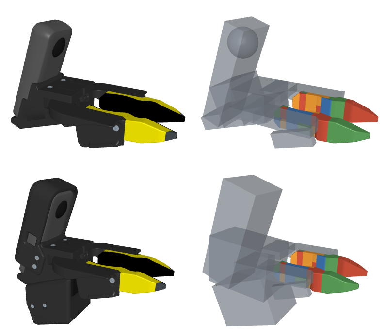
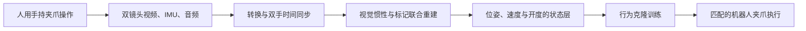
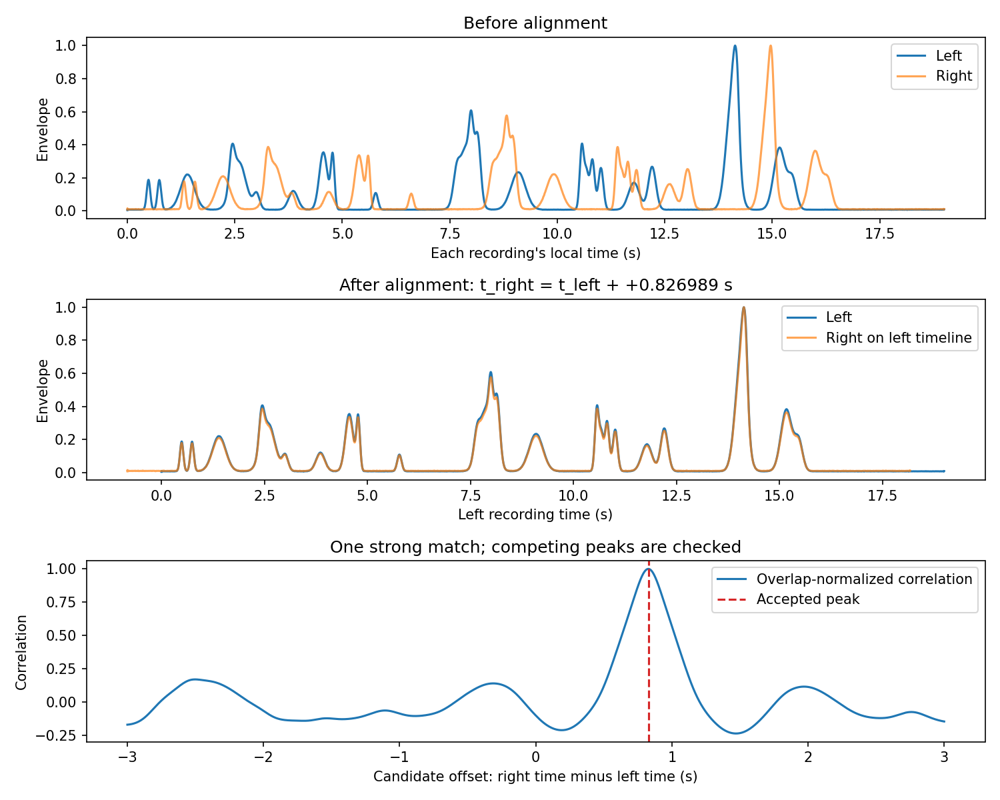
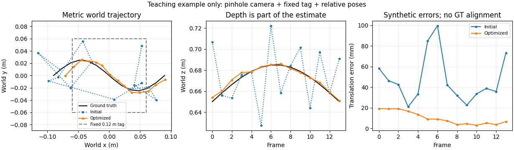

# Specialist Gripper 中文调研：硬件、双手同步与世界坐标轨迹重建

- 调研日期：2026-11-10（新加坡时间）。
- 对象：UC Berkeley Specialist 手持／驱动式夹爪，以及官方数据重建代码。
- 交付：硬件与发布状态核查、算法解释、官方图、两个可运行的教学示例及合成数据验证。
- 验证边界：已阅读官方源码与装配手册；未取得真实 `.insv`、动捕真值或实物，未运行完整官方 CUDA 重建、策略训练或真机控制。示例结果仅证明教学代码在合成数据上的行为。

## 1. 核心结论与阅读导航

Specialist 将人手上的操作示范转为机器人可学习的数据：人使用手持夹爪完成任务，相机记录视频、IMU 和音频；采集结束后，系统重建具有真实尺度的六自由度轨迹与夹爪开度；机器人使用夹指几何和相机位置匹配的驱动式夹爪执行策略。

其主要价值是降低真实场景示范采集的门槛。它不是 SuperMimic 的世界模型／BPTT 操作版；官方当前介绍的策略训练路线是行为克隆。

| 想了解的问题 | 阅读位置 |
|---|---|
| 硬件怎样组成，如何搭建 | 第 2–3 节 |
| 左右录像怎样通过声音对时 | 第 4 节及 [audio_align.py](examples/audio_align.py) |
| 标记怎样确定尺度、空间关系和坐标系 | 第 5 节 |
| 因子图怎样改善轨迹一致性 | 第 6 节及 [world_trajectory.py](examples/world_trajectory.py) |
| 如何评价毫米级精度 | 第 7 节 |
| 如何运行官方流程及本报告示例 | 第 8–9 节 |
| 哪些已经开源，哪些仍未核实 | 第 10 节 |

## 2. 硬件结构：一种操作几何，两种使用方式



图 1：官方模型渲染。上排为手持版，下排为驱动版；右列是仿真碰撞几何，不是透视照片。来源与 MIT 许可见[图像说明](assets/README.md)。

| 项目 | 手持版 | 驱动版 | 本次证据 |
|---|---|---|---|
| 用途 | 人直接操作并录制示范 | 装在机械臂上执行 | 官方总览与模型仓库 |
| 相机 | 每夹爪 1 台 Insta360 X3 | 每夹爪 1 台 Insta360 X3 | 官方装配手册 |
| 开合驱动 | 手指驱动，含复位机构 | Feetech STS3215，12 V | 官方手册与模型 |
| 打印零件数 | 6 件 | 11 件 | 官方手册 |
| 打印／装配时间 | 约 5 小时／6 分钟 | 约 7.5 小时／20 分钟 | 手册给出的估计，非本次实测 |
| 指尖结构 | TPU 95A 主体＋PLA 指甲 | 相同 | TPU 主体要求 100% 填充 |
| 报道成本 | 320 美元／夹爪 | 380 美元／夹爪 | 来自用户提供的报道，未独立核验计价范围 |
| 报道含相机质量 | 315 克 | 480 克 | 未在此次可访问手册中独立核实 |

双手采集需要两台相机。不要把单夹爪报价当作包含机械臂、计算机和两套设备的总成本；相机是否计入报价、税运与打印耗材等应逐项核对 BOM。

手持版与驱动版的夹指、相机位置相匹配，有助于减少示范与执行之间的动作、视角差异。但机械臂仍需完成逆运动学、轨迹跟踪和约束检查，不能因此假设任何机械臂都能执行所有示范。

### 2.1 为什么使用两颗背靠背鱼眼镜头

每台 X3 具有两颗鱼眼镜头和内置 IMU。观察镜头拍摄指尖与工作区，主要服务策略输入；辅助镜头能观察更广的环境和锚点，为轨迹重建补充约束。

夹爪伸入抽屉时，操作画面可能只剩缺乏纹理的近处表面；另一侧镜头仍可能看到房间。广视野也使夹爪转动时更容易保留可追踪特征。

这不是普通前向双目测深结构。不能把背靠背鱼眼直接当成有大量重叠视野的立体相机，也不能默认拼接后的全景视频适合精确几何重建。官方流程使用各镜头的标定与 MEI 投影模型。

### 2.2 从示范到训练数据



重建轨迹的目的，是为画面补上动作标签：当时夹爪在哪里、如何转动、开了多大，接下来怎样运动。相机视角和工具坐标系之间仍需通过已知外参转换。

## 3. 搭建与采集前应确认什么

1. 从官方发布页取得手持版或驱动版手册、对应 STEP 和打印文件，避免混用不同几何版本。
2. 根据手册核对材料、填充率、紧固件、弹簧及相机固定方式。连接应足够刚性，防止采集中外参变化。
3. 使用对应的相机内参、鱼眼模型、镜头／IMU 外参和夹爪几何。更换相机或安装位置后应重新核验。
4. 按实际检测边界测量标签边长，避免打印软件自动缩放。官方当前配置使用 `tagStandard41h12`；锚点与夹爪标签尺寸分别有独立配置。
5. 将锚点固定在不随操作移动的位置，确保相机—锚点—另一只夹爪之间存在足够的观测连接。
6. 开始和结束时安排可辨认的共同声音事件，录制中避免持续相同节拍；检查曝光、模糊与标记可见度。

第 6 点是本报告的采集建议，不是官方对所有录制的强制要求。官方同步可以利用环境中的共同声音，但含糊的音频峰应被拒绝。

不要把“偶尔看见锚点”视为足够。当前初始化实现要求选定锚点在至少 8 个且约四分之一关键帧中可见，否则拒绝生成轨迹初值。应在正式扩大采集前，用短录制检查覆盖情况。

手册入口：[手持版 PDF](https://github.com/specialist-ai/specialist_description/releases/download/v0.1.0/specialist_handheld_manual_v0.1.0.pdf)、[驱动版 PDF](https://github.com/specialist-ai/specialist_description/releases/download/v0.1.0/specialist_actuated_manual_v0.1.0.pdf)。发布资产路径为 `v0.1.0`，PDF 元数据却显示另一版本标识；应保留实际下载文件与哈希，不据此假定所有代码提交使用同一几何。

## 4. 左右夹爪怎样用声音同步

### 4.1 先固定时间符号

与官方代码保持一致，令 A 为左相机、B 为右相机：

$$
t_R = t_L + \Delta
$$

同一个敲击若出现在左录像 10.000 秒、右录像 11.372 秒，则 $\Delta=+1.372$ 秒。把右侧事件转换到左侧时间轴时：

$$
t_{R\rightarrow L}=t_R-\Delta
$$

这描述同一事件在两个本地时钟中的读数差，不能仅凭正负号口语判断哪台“晚开始”。官方 `convert.py` 保存相机时钟减会话时钟的偏移，再以其负值平移视频、IMU 和曝光时间。

### 4.2 官方同步实现

在本次固定的源码中，流程为：

1. 将音轨解码为 16 kHz 单声道。
2. 取绝对值，使用四阶、50 Hz 截止频率的零相位低通滤波提取幅度包络。
3. 每 16 点抽取一次，得到约 1 kHz 的相关计算时间轴，并去均值。
4. 用 FFT 计算互相关，在正负 30 秒内寻找最高峰。
5. 用峰附近的抛物线插值细化偏移估计。
6. 排除主峰周围正负 0.25 秒，再寻找竞争峰；峰值比低于 1.3 时拒绝同步。

简化表达为：

$$
\Delta^*=\arg\max_\Delta\sum_t e_L(t)e_R(t+\Delta)
$$

其中 $e_L,e_R$ 是包络。峰值比是启发式质量指标，不是正确概率，也不是毫秒误差的置信区间。零相位滤波使用前后数据，适合离线处理，不是实时因果滤波。

源码：[audio_sync.py](https://github.com/specialist-ai/specialist/blob/da29719cdbaa366df0599984068ad4553d9cc86d/src/specialist/loader/audio_sync.py)、[convert.py](https://github.com/specialist-ai/specialist/blob/da29719cdbaa366df0599984068ad4553d9cc86d/scripts/convert.py)。

### 4.3 教学代码与视频裁剪

本报告提供独立编写的 [audio_align.py](examples/audio_align.py)，读取 PCM WAV，输出偏移、重叠区间和质量信息。其额外检查与官方实现的区别以代码说明为准，不能把它当成 `.insv` 转换器。

核心调用如下；这些函数定义在示例脚本中：

```python
from pathlib import Path
from examples.audio_align import read_wav, estimate_offset

left = read_wav(Path("left.wav"))    # 统一到 16 kHz
right = read_wav(Path("right.wav"))
result = estimate_offset(left, right, max_offset=5)
offset = result["offset_seconds"]
right_event_time = 11.372             # 示例：右录像中记录的事件时间
right_event_on_left_clock = right_event_time - offset
```

最后一行中的 `right_event_time` 是待转换的实际右侧事件时间。教学代码使用重叠窗口归一化相关，并增加静音、弱相关、短重叠和边界峰检查；这与官方的全局去均值相关并不完全相同。



图 2：合成录音的包络与相关峰。第二幅图将右时钟减去估计偏移后映射到左时间轴；图中结果不代表实机对时精度。

从可读取的录像中提取音轨：

```bash
ffmpeg -i left.insv -map 0:a:0 -vn -ac 1 -ar 16000 -c:a pcm_s16le left.wav
ffmpeg -i right.insv -map 0:a:0 -vn -ac 1 -ar 16000 -c:a pcm_s16le right.wav
python examples/audio_align.py left.wav right.wav --max-offset 5
```

上述命令在 `specialist-research` 目录执行。`.insv` 包含多文件／多流结构，实际处理应优先使用官方转换器，而不是随意选一个镜头文件或丢弃原始时间戳。

若左右时长为 $D_L,D_R$，共同区间在左时钟中为：

$$
t_{\rm start}=\max(0,-\Delta),\qquad
t_{\rm end}=\min(D_L,D_R-\Delta)
$$

左视频从 $t_{\rm start}$ 开始，右视频从 $t_{\rm start}+\Delta$ 开始，两者截取相同的正时长。独立导出预览时可用 FFmpeg 的 `trim` 与 `setpts`；用于训练则应保留原始帧 PTS 与会话时间的对应，不只凭帧序号配对。

尤其要确认音轨首样本与视频首帧的 PTS 差。对 WAV 求出的偏移只有在两个 WAV 的时间原点分别正确对应录像时，才能直接用于视频。

### 4.4 常数偏移不等于解决所有时间误差

- **时钟漂移：**当前官方同步估计单一常数偏移。长录制可在多个窗口估计 $\Delta(t)$，检查是否需要 $t_R=a t_L+b$；漂移校正属于扩展工作，不能宣称已由当前示例完成。
- **传播时延：**声音每传播 1 米约需 2.9 毫秒。两只麦克风到声源的距离差会混入估计偏移。
- **静音与重复声：**静音、周期音乐、独立声源或强混响可能导致错误峰，应拒绝或人工复核。
- **音视频与视频—IMU时差：**双手音轨对齐不会自动标定相机内部的所有传感器延迟。

运动速度为 $v$、时间误差为 $\delta t$ 时，位置误差量级约为 $v\delta t$。例如 1 m/s 下的 10 ms 对时误差就对应约 10 mm 位移；这是量级示例，不是该系统的实测误差。

## 5. 世界坐标、真实尺度与双手空间关系

### 5.1 标记为什么能提供尺度

打印标记提供已知大小的几何。以边长 $L$ 的方形标签为例，其四角在标签坐标中的位置可写为 $(\pm L/2,\pm L/2,0)$。相机检测角点后，结合投影模型与内参，估计标签相对镜头的位姿；输入的 $L$ 使用米，平移估计也就具有米制尺度。

若把实际 0.1 m 的标记误配为 0.2 m，标记独立位姿估计会产生相应尺度偏差；联合 IMU 后还可能表现为相互冲突的残差。优化不能修复错误的物理尺寸配置。

本次官方配置的默认锚点边长为 0.1 m、夹爪标签边长为 0.01 m；应按实际打印与对应源码版本核验，而不是直接照抄。

### 5.2 统一变换约定

本文用 ${}^{A}T_B$ 表示从 B 坐标到 A 坐标的变换：

$$
p_A={}^{A}T_Bp_B
$$

令 W 为世界，C 为已明确的相机坐标系，G 为夹爪／工具坐标系：

$$
{}^{W}T_G={}^WT_C\,{}^CT_G
$$

如果左相机看到右夹爪标记 M，则：

$$
{}^LT_R={}^LT_{C_L}\,{}^{C_L}T_{M_R}\,{}^{M_R}T_R
$$

中间项来自图像观测，两侧来自几何与外参。实际代码还有机身、IMU、不同镜头和指节坐标，必须核对所用外参方向及单位，不能把任意名为 `camera` 的坐标系直接混用。

### 5.3 重要修正：官方世界坐标不是简单令标签位姿为单位阵

为了讲解，常可把世界坐标直接定义为某个标签坐标。但本次官方实现更具体：**保留重力竖直方向，以首个参考锚点确定原点和水平朝向。** 首锚点 x 轴在水平面的投影用于确定 yaw；其倾斜角不被硬锁成零，而由重力相关信息约束。

`align_to_shared_world` 对各轨迹进行平移与 yaw 对齐；`anchor_gauge_prior` 强约束首锚点的位置和 yaw，同时放开 tilt。这样锚点贴在墙上时，不会把墙面法向误当作重力竖直方向。

源码：[compose.py](https://github.com/specialist-ai/specialist/blob/da29719cdbaa366df0599984068ad4553d9cc86d/src/specialist/vi_ba/compose.py)。

本报告世界轨迹示例使用已知锚点角坐标定义的固定 W，不实现上述完整重力初始化。这是明确的教学简化。

### 5.4 多夹爪需要观测图连通

各夹爪可以通过共同锚点、锚点之间的共同观测，以及相互标记观测获得空间联系。并非任意两段独立录像都能仅靠优化合并。

若两只夹爪从未看到共同参考，也不存在跨设备观测连接，那么它们之间的相对位置可能不可观。官方初始化会检查相机—锚点的共视连接，不能用更强的优化器代替缺失信息。

更严格地说，当前版本首先按相机—锚点共视图初始化共享世界系；后续相互标记因子不能绕过这个实现前置条件。

### 5.5 输出基座轨迹不等于指尖 TCP 轨迹

官方状态层输出的是夹爪 **base-tag frame** 的位姿与速度旋量，并非自动得到某个指尖接触点的 TCP。若目标是工具或指尖，应明确其标定变换；活动指尖的位置还取决于开度与运动学。

对固定工具点，最小的变换计算为：

```python
W_T_G = W_T_C @ C_T_G     # 两个 4×4 刚体变换
tool_origin_world = W_T_G[:3, 3]
```

例如，当相机在旋转时，偏离相机中心的工具点即使没有额外平移指令，也会运动。对应速度需要杠杆臂项：

$$
v_W^{tag}=v_W^{body}+\omega_W\times\left(R_W^{body}p_{body}^{tag}\right)
$$

忽略该项，会把相机中心速度错误地当成夹爪参考点速度。源码：[state.py](https://github.com/specialist-ai/specialist/blob/da29719cdbaa366df0599984068ad4553d9cc86d/scripts/state.py)。

## 6. 因子图怎样重建轨迹

### 6.1 变量、因子与残差

| 变量／约束 | 直观含义 |
|---|---|
| 多时刻位姿、速度和 IMU 偏置 | 求解设备怎样运动，以及惯性测量的系统偏差 |
| 场景特征点 | 相机在不同画面中看见的固定参考 |
| 视觉重投影因子 | 用当前位姿预测像素，与实际检测位置比较 |
| IMU 预积分因子 | 用两个关键帧之间的高频惯性测量约束运动 |
| 锚点与夹爪标签因子 | 将已知尺寸的标记与设备几何纳入估计 |
| 跨夹爪因子 | 用一只夹爪看到另一只夹爪标记的观测连接轨迹 |

简化的优化形式是：

$$
X^*=\arg\min_X\sum_i\rho_i\left(r_i(X)^T\Sigma_i^{-1}r_i(X)\right)
$$

$X$ 是待估变量，$r_i$ 是观测残差，$\Sigma_i$ 是噪声协方差，$\rho_i$ 为可选的鲁棒损失。像素、米和弧度必须按噪声量级归一化，不能把不同单位直接相加。

优化器从初值出发，线性化残差并反复更新。它是在求整体一致性，而不是把几路传感器的位置简单平均。初值、外参、时序或可观测性有问题时，低残差也不保证真实轨迹准确。

### 6.2 为什么鱼眼模型和外参重要

视觉因子计算的是“当前估计下，这个三维点应该落在哪个像素”。若投影模型不对，优化器可能通过扭曲轨迹去补偿模型错误。

官方使用 MEI 模型和原生角点因子；未经标定与正确重投影，不应把原始鱼眼角点直接送入普通针孔 `solvePnP`。

### 6.3 教学示例展示什么

[world_trajectory.py](examples/world_trajectory.py)使用固定随机种子生成已知世界轨迹、标记角点观测及有噪声的相邻相对位姿，通过加权鲁棒最小二乘优化多时刻六自由度位姿。

它演示：

- 已知米制锚点如何固定世界参考；
- 如何组合相机和工具外参；
- 视觉重投影与相对运动约束怎样共同改善轨迹；
- 如何对照独立的合成真值计算位置、旋转和重投影误差。

**它不实现原始鱼眼处理、真实 IMU 预积分或完整 GTSAM 图。** 相对位姿约束是合成输入，不能把它当成读取真实陀螺仪和加速度计的方法。示例使用已标定的针孔／校正图像模型。

评测不进行事后 Sim(3) 尺度拟合或自由刚体对齐，避免把坐标／尺度错误隐藏在真值对齐中。



图 3：固定米制锚点下的合成相机轨迹。此示例初值由真值加扰动得到，仅为了演示局部优化，不是实际录像初始化方法。误差测量的是相机原点；转换为夹爪原点还需外参。

## 7. 怎样判断世界坐标轨迹是否精确

### 7.1 把误差拆开

| 误差来源 | 可能现象 | 建议检查 |
|---|---|---|
| 标签尺寸或打印平整度 | 尺度偏差、位置随视角变化 | 实测检测边界、固定平面、正确配置 |
| 相机内参与畸变 | 边缘像素残差大、轨迹系统偏差 | 逐镜头标定与不同视角检查 |
| 相机—IMU／工具外参 | 转动时出现位置偏差 | 刚性安装、核对坐标轴与变换方向 |
| 对时错误 | 快速运动时双手相互观测矛盾 | 检查偏移符号、A/V PTS 和长时漂移 |
| IMU 偏置或标定不足 | 遮挡期间漂移 | 静止数据、偏置估计和运动激励 |
| 模糊、反光与遮挡 | 错误特征、标签跳变 | 曝光、速度、照明及异常观测剔除 |
| 图不连通／缺少参考 | 多设备轨迹无法统一 | 检查共视关系与锚点可见性 |

### 7.2 不把像素残差当毫米精度

重投影 RMS 衡量像素拟合程度；世界位置误差需要外部真值，例如独立动捕、已知几何夹具或精密位移台。

推荐至少报告：位置误差的中位数、RMSE、P90／P95，旋转误差，静止抖动，已知距离误差，长序列漂移，以及双手相对位姿误差。明确测量的是相机、夹爪基座还是指尖。

如果必须对齐动捕与重建坐标，应用独立标定段确定一次固定变换，并报告对齐方法；不能在每段测试轨迹上重新拟合尺度以掩盖错误。

报道给出的 3.0 mm 中位误差、6.6 mm P90、97.3% 帧小于 10 mm，来自其描述的 11 次采集与 19,716 帧。本次尚未取得原论文及原始真值复核，不能将这些数字写成本报告复现实测，也不能推广为机器人执行精度。

报道中的 Specialist 中位数与 UMI 在其他基准上的平均 ATE，也不能直接计算精度提升倍数。

### 7.3 最小实物验证顺序

1. 固定夹爪静止录制，检查抖动、偏置与标记检测稳定性。
2. 沿已知长度导轨缓慢运动，检查尺度和轴方向。
3. 固定一点转动，检查相机—工具外参导致的杠杆臂效应。
4. 将两个设备固定在同一刚性支架上移动，检查重建的相对变换是否稳定。
5. 做短时遮挡与回看锚点，检查漂移和重定位一致性。
6. 增加速度、延长录制，再检查时间偏差与世界轨迹误差的关系。

## 8. 官方数据管线：从 `.insv` 到状态层

以下是源码 README 中的命令形式，需要在**官方 specialist 仓库**执行，不能在本调研目录直接运行：

```bash
uv sync

uv run python scripts/convert.py \
  --input-insvs path/to/left_00.insv path/to/right_00.insv \
  --output-dir logs

uv run python scripts/estimate.py \
  --base logs/base/<session-id>.rrd \
  --anchor.tag-ids 0 1 --output-dir logs

uv run python scripts/state.py \
  --base logs/base/<session-id>.rrd --output-dir logs
```

`<session-id>` 和锚点 ID 必须替换为本次采集实际值。转换器根据每台相机的 `_00_` 主文件查找 `_10_` 配对文件，并取所有设备共同覆盖的时间区间。

主要输出：

```text
logs/base/<session-id>.rrd        视频、IMU、标定与时钟关系
logs/estimate/<session-id>.rrd    求解出的位姿和关节角
logs/viz/<session-id>.rrd         可视化信息
logs/state_s8_r100/<session-id>.rrd 训练用状态层
```

轨迹包含关键帧联合优化与 IMU 高频传播，状态层再以 SLERP／线性插值采样至 100 Hz，图像仍保留自身的采集时刻。这不会创造 100 Hz 独立视觉测量，也不能单凭输出频率宣称轨迹精度。源码：[highrate.py](https://github.com/specialist-ai/specialist/blob/da29719cdbaa366df0599984068ad4553d9cc86d/src/specialist/vi_ba/highrate.py)、[state.py](https://github.com/specialist-ai/specialist/blob/da29719cdbaa366df0599984068ad4553d9cc86d/scripts/state.py)。

### 8.1 当前官方运行条件

本次固定的 `pyproject.toml` 要求 Python `>=3.14,<3.15`、`gtsam==4.3.0`。默认安装包含开发与 GPU 组；估计入口要求 CUDA 后端，原生 MEI 因子需要 C++17 编译器。

因此，本报告的 Python 3.12 教学示例成功，不代表官方完整管线已安装或可以在 CPU 上直接运行。若面向 DGX Spark ARM64，还要单独核验 CUDA 包与原生依赖；相机在线驱动目前明确携带 Linux x86_64 的厂商 SDK，不能据此声称 ARM64 部署成立。

## 9. 运行本报告的教学代码

两个示例仅依赖 NumPy、SciPy；生成图时还使用 Matplotlib。示例依赖与官方 Specialist 依赖分开管理。

```bash
cd specialist-research
python3 -m venv /tmp/specialist-demo-venv
/tmp/specialist-demo-venv/bin/python -m pip install -r requirements-demo.txt

export MPLCONFIGDIR=/tmp/specialist-matplotlib
/tmp/specialist-demo-venv/bin/python examples/audio_align.py --self-test
/tmp/specialist-demo-venv/bin/python examples/world_trajectory.py --self-test
```

可用音频从实际录音导出；在没有真实硬件数据时，先运行合成自检。自检覆盖偏移符号、异常音频拒绝，以及世界变换与优化误差等行为。详细命令与结果见[示例验证记录](examples/VALIDATION.md)。

合成图仅用于解释算法与误差评估，不能作为 Specialist 的硬件性能证据。

本次独立环境复跑结果：音频四项自检通过；默认 seed 7 的轨迹结果如下。

| 合成指标 | 初始值 | 优化后 |
|---|---:|---:|
| 相机位置 RMSE | 52.532 mm | 11.736 mm |
| 相机旋转 RMSE | 4.496° | 0.987° |
| 相对无噪声真值角点的投影分量 RMSE | 35.139 px | 0.495 px |

这里刻意展示了“像素误差很小，位置误差仍可能超过 1 cm”。平面小标记的观测几何、噪声和外参都会影响位置精度，不能用低像素残差直接承诺毫米精度。

## 10. 发布状态、许可与适用边界

| 组件 | 本次公开核查结果 |
|---|---|
| `specialist_description` | 硬件模型及发布资产可访问 |
| `specialist` | 数据转换、视觉惯性重建与状态输出代码可访问 |
| `specialist_sdk`、`feetech_driver`、`insta360_driver` | 驱动代码可访问 |
| `specialist_bc`、`specialist_lerobot` | 官方总览标注 `coming soon` |
| `specialist_arm`、`specialist_sim` | 总览有链接，但本次匿名访问返回 404 |
| 论文 | 官方总览标注 `Paper (coming soon)` |
| 训练数据与预训练权重 | 本次未核实到可用下载入口 |

前述五个可访问的代码仓库使用 MIT 许可；相机 CameraSDK 与固件另有边界。相机驱动 README 明确说明厂商 SDK 的分发限制，不应把项目源码许可延伸到所有依赖。

官方描述的行为克隆训练、ONNX 导出及 TensorRT 部署是其系统规划／介绍的一部分；发布状态尚不足以证明整个链路目前都能公开复现。

从已有资料看，Specialist 主要适合研究便携式示范采集与操作学习。它不能仅凭少数自主演示证明通用操作能力；手持录制咖啡制作、组装夹爪等任务，也不代表机器人已经自主完成全部这些任务。

## 11. 来源与版本记录

| 编号 | 一手来源 | 本次固定版本／用途 |
|---|---|---|
| S1 | [官方项目总览](https://github.com/specialist-ai/.github/blob/678ca88c537d78e353a4dd0b505fc0208ff4ab8a/profile/README.md) | 项目定位、组件与发布状态 |
| S2 | [数据重建 README](https://github.com/specialist-ai/specialist/blob/da29719cdbaa366df0599984068ad4553d9cc86d/README.md) | 管线与数据层 |
| S3 | [音频同步源码](https://github.com/specialist-ai/specialist/blob/da29719cdbaa366df0599984068ad4553d9cc86d/src/specialist/loader/audio_sync.py) | 偏移符号、滤波与峰值判别 |
| S4 | [坐标系与联合图构建](https://github.com/specialist-ai/specialist/blob/da29719cdbaa366df0599984068ad4553d9cc86d/src/specialist/vi_ba/compose.py) | 世界参考、跨夹爪约束 |
| S5 | [标记与求解配置](https://github.com/specialist-ai/specialist/blob/da29719cdbaa366df0599984068ad4553d9cc86d/src/specialist/vi_ba/configs.py) | 标签尺寸、噪声与参数 |
| S6 | [硬件模型](https://github.com/specialist-ai/specialist_description/tree/56985a8b32018929b07f337bb0a5602e9b8d6f7a) | 两种夹爪、原图与许可 |
| S7 | [相机驱动 README](https://github.com/specialist-ai/insta360_driver/blob/22641e241c18857f345fbbf8643592194beefb7f/README.md) | 相机延迟、SDK、平台限制 |
| S8 | [夹爪 SDK](https://github.com/specialist-ai/specialist_sdk/tree/ad2b18144fdbe3fa99cfa27237aa02863a17bee4) | 开度约定、标定与驱动边界 |

其他入口：[项目主页](https://specialist-ai.github.io/)、[搭建文档](https://specialist-ai.github.io/specialist-docs/)、[硬件发布页](https://github.com/specialist-ai/specialist_description/releases/tag/v0.1.0)。前两个站点在本次环境中受访问策略限制，本文以可访问的一手仓库与下载手册核查，不将报道转述当作完整原论文验证。

用户提供的 SourceMind 报道作为二手线索使用。成本、质量及追踪性能等未独立验证的数字已在对应段落注明；本文未复刻报道全文或视频。
