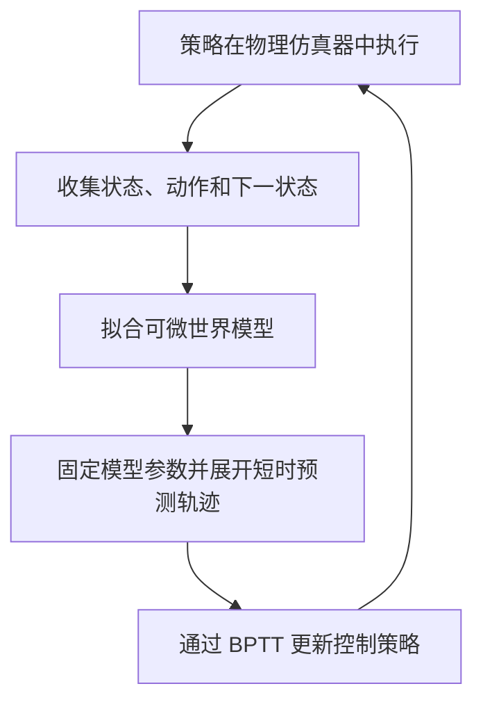

# SuperMimic 中文调研

- 日期：2026-11-09（新加坡时间）。
- 文档性质：SuperMimic 方法与 BPTT 策略训练的中文调研。
- 验证状态：本文为资料整理与原理说明，未在本仓库执行训练、仿真对照或真机实验。

## 1. 论文与资料入口

**论文原名：** *SuperMimic: Scaling Humanoid Whole-Body Control with One Differentiable World Model*。

**中文译名：**《SuperMimic：通过单一可微世界模型扩展人形机器人全身控制能力》。此中文标题为本文译名。

**作者：** Qiayuan Liao、Yiyang Shao、Junfeng Long、Kevin Zakka、Roberto Horowitz、Pieter Abbeel、Koushil Sreenath。

| 资料 | 链接 | 使用方式 |
|---|---|---|
| 原论文摘要页 | <https://arxiv.org/abs/2610.28480> | 方法与实验结论的原始入口 |
| 原论文 PDF | <https://arxiv.org/pdf/2610.28480> | 核对公式、观测、奖励、数据划分和评测协议 |
| 项目与演示 | <https://supermimic.github.io/> | 查看作者展示的任务和运行效果 |
| SuperMimic 独立复现 | <https://github.com/CuboiLeo/SuperMimic-Reproduced> | 参考实现、实验记录和失败分析；与原论文区分 |
| 另一份独立复现 | <https://github.com/zita-ch/supermimic_vibed> | 比较工程选择和评测条件；不作为官方实现使用 |

调研边界：本次整理读取了可访问的 SuperMimic 独立复现说明与实验记录；原论文站点和项目站点在整理时的环境中访问受限。本文不声称已完成原论文全文逐式审读，也不将复现者的结果归为原论文结果。正式实现前需固定论文版本、代码提交、数据版本和评测协议，并再次核对原文。

以下公式用于解释基本原理，不是对论文完整目标函数的逐式转录。本文不引用未经核实的性能倍数或成功率。

## 2. SuperMimic 解决什么问题

**SuperMimic 是一种用于人形机器人动作跟踪的基于模型的强化学习方法。** 它学习机器人执行动作后的动力学变化，再利用这个可微模型中的短时预测轨迹优化控制策略。

动作跟踪要求机器人在自身关节、执行器和接触约束下，尽量完成参考运动。例如，参考动作给出身体姿态和运动轨迹，控制策略需要生成能够实际维持平衡并跟踪动作的控制指令。

SuperMimic 关注的关键问题是：能否利用学到的动力学及其梯度，更高效地训练覆盖多种动作技能的控制策略。

“单一世界模型”指共享动力学支持同一机器人上的多种动作技能。它不自动意味着能够控制任意未见过的机器人身体。

## 3. 系统中的学习组件

| 组件 | 输入与输出 | 作用 |
|---|---|---|
| 世界模型 | 当前物理状态、动作及必要环境条件 → 下一状态预测 | 学习动作如何影响机器人运动 |
| 控制策略 | 机器人观测与参考动作 → 控制动作 | 选择有助于动作跟踪的控制指令 |
| 价值函数（critic） | 状态及任务条件 → 后续收益估计 | 为有限长度的预测轨迹提供后续价值信息 |

世界模型预测的是身体的物理状态，例如关节状态、姿态和速度，并非生成视频。训练时的完整仿真状态与部署时可获得的传感器观测是不同概念，不能混同。

世界模型和控制策略构成理解该方法的核心；价值函数则帮助策略训练考虑预测窗口之外的收益。

## 4. 交替训练流程

1. **采集仿真经验。** 策略在物理仿真器中控制机器人，产生“当前状态—动作—下一状态”的数据。
2. **拟合世界模型。** 利用采集的数据学习动力学，检查单步及多步预测能力。
3. **在世界模型中优化策略。** 从采集的状态出发生成短时预测轨迹，利用时间反向传播计算策略梯度。
4. **回到物理仿真采集新数据。** 更新后的策略访问新的状态，形成下一轮模型与策略训练的数据。



**物理仿真器本身不需要可微。** 可微的是学到的动力学近似模型。接触、碰撞等物理过程由仿真器产生数据，并通过独立评测检验模型中得到的策略是否有效。

## 5. BPTT 如何用于策略训练

### 5.1 BPTT 是梯度计算方法

**BPTT（Backpropagation Through Time，时间反向传播）把连续多步计算展开，再沿时间反向计算梯度。** “BPTT 策略”更准确的表达是“通过 BPTT 训练的控制策略”，它不是一个独立的策略网络类型。

以迈步为例：当前脚踝动作稍有变化，可能影响下一步落脚位置，随后影响重心，最终决定是否失稳。BPTT 尝试计算：若希望后续更稳定、跟踪更准确，当前动作以及生成这些动作的策略参数应如何调整。

### 5.2 展开状态与动作

用以下关系说明基本过程：

$$
o_t = h(s_t), \qquad a_t = \pi_\theta(o_t, g_t)
$$

$$
s_{t+1} = f_\phi(s_t, a_t)
$$

其中：

- $s_t$：当前物理状态。
- $o_t$：从状态构造的策略观测；实际实现也可能使用观测历史。
- $g_t$：参考动作目标。
- $\pi_\theta$：参数为 $\theta$ 的控制策略。
- $f_\phi$：参数为 $\phi$ 的世界模型。
- $a_t$：策略输出的控制动作。

这里省略了环境条件等额外输入。连续调用策略与世界模型，就得到：

```text
状态 s₀ → 策略 → 动作 a₀ → 世界模型 → 状态 s₁
                                           ↓
                                          策略
                                           ↓
                                         动作 a₁
                                           ↓
                                         世界模型
                                           ↓
                                         状态 s₂ → ……
```

同一组策略参数会在多个时间步重复使用。当前动作不仅影响当前奖励，也通过后续状态影响未来动作与奖励。

### 5.3 从累计收益计算梯度

一个用于说明的有限时域目标是：

$$
J(\theta) = \mathbb{E}\left[
\sum_{t=0}^{H-1} \gamma^t r(s_t, a_t, g_t)
+ \gamma^H V_\psi(s_H, g_H)
\right]
$$

其中，$H$ 是预测轨迹长度，$\gamma$ 是折扣因子，$r$ 是奖励，$V_\psi$ 是末端价值估计。末端项用于近似预测窗口之外的收益，不意味着必须把整段动作全部展开。

BPTT 沿展开的轨迹计算：

$$
\nabla_\theta J(\theta)
$$

策略可以通过梯度上升提高收益，也可以把负收益作为损失进行梯度下降。梯度同时包含动作对当前收益的影响，以及动作通过改变后续状态而对未来收益产生的影响。

实际 SuperMimic 实现还涉及终止处理、价值函数训练、采样及稳定化措施，应以固定版本的论文和代码为准，不能把上述教学公式直接当作完整算法。

### 5.4 固定世界模型参数，保留梯度通路

策略更新阶段通常固定世界模型参数，但仍允许梯度经过世界模型传回动作和策略。

**“不更新模型参数”与“禁止对模型计算求导”是两回事。** 如果直接把整个世界模型前向过程放入 `no_grad`，就会切断动作影响后续状态的梯度通路。

价值函数用于策略目标时也应区分参数更新与输入求导。是否对末端价值保留状态梯度，要遵循所实现的具体目标函数；不能仅因为暂时不更新 critic 参数，就默认切断所有相关梯度。

世界模型通过独立的数据拟合阶段更新，策略通过模型中的预测轨迹更新。这两类更新的目标不同。

### 5.5 BPTT 不要求策略是循环网络

即使策略是普通前馈网络，只要动作通过状态转移连接多个时间步，就能沿时间展开求导。BPTT 的关键是跨时间的计算依赖，不是是否使用 RNN、LSTM 或其他特定网络。

## 6. 与 PPO 的比较

| 比较项 | PPO | 通过世界模型进行 BPTT 的策略训练 |
|---|---|---|
| 主要学习信号 | 采样轨迹、优势估计和策略概率比目标 | 穿过预测动力学的梯度，并可结合价值估计 |
| 是否需要可微动力学模型 | 不需要 | 需要可微的预测模型 |
| 如何考虑未来结果 | 利用回报与价值函数估计 | 沿预测轨迹求导，并近似更远期收益 |
| 主要开销 | 仿真采样与策略更新 | 采样、世界模型训练和预测轨迹反向传播 |
| 主要挑战 | 样本成本、估计波动与训练稳定性 | 模型误差、梯度可靠性、显存与计算开销 |

PPO 同样优化长期收益。关键区别是：PPO 通常不对“动作如何改变环境状态”的动力学过程求导，而 SuperMimic 类方法利用学到的模型进行这一步求导。

PPO 也通过反向传播训练网络；采用循环策略时，还可能通过 BPTT 训练策略内部的隐藏状态计算。因此，PPO 与 BPTT 不是互斥概念。本节比较的是 PPO 通常使用的策略梯度路径，与穿过世界模型状态转移的梯度路径。

因此，减少交互样本量不自动等于缩短实际训练时间。评价效率时应分别报告交互量、墙钟时间和总计算成本，包含世界模型训练与必要的编译预热等开销。

## 7. “想象训练”与实际部署

这里的“想象”是世界模型中的短时状态预测，主要用于训练。它不等于生成视频，也不意味着机器人在每个控制周期都搜索大量未来路径。

部署时可以直接运行训练好的策略，根据传感器观测和目标输出动作，不必每步执行 BPTT。训练过程使用的世界模型、critic 和反向传播计算，也不意味着都必须保留在部署控制回路中。

## 8. 局限与需要验证的问题

### 8.1 模型可能被策略利用

接触、冲击、滑动和未覆盖的状态都可能导致模型误差。策略可能利用这些误差，使预测收益升高，而实际仿真表现没有改善。必须回到独立的物理仿真或真机评测。

### 8.2 预测准确不保证梯度准确

状态预测接近真实，不代表模型正确估计了“动作略微改变后会发生什么”。因此，需要分别检查预测误差、策略更新后的实际收益，以及动作是否出现异常。

### 8.3 长轨迹的误差与资源成本

预测窗口越长，模型误差越容易累积，反向传播的显存和计算成本通常也越高，还可能出现梯度消失或爆炸。有限长度的展开能控制部分风险，但会引入对末端价值估计的依赖。

### 8.4 接触转换与长时漂移

落脚、离地、滑动和碰撞附近尤其需要检查多步预测。应区分不同运动阶段，避免平均误差掩盖少量关键失败。

独立复现资料记录了长动作中的漂移问题，并发现其表现与观测中是否提供参考锚点信息有关。这属于复现者的观察，不能直接归为原论文结论；它提示评测时需要同时检查动作长度、坐标定义和状态可观测性。

## 9. 如何阅读和评估 SuperMimic 结果

阅读论文或复现报告时，应核对：

- **任务范围：**训练动作与未见动作是否分开，动作片段有多长，是否包含连续长时控制。
- **输入信息：**策略是否获得额外的位置、朝向、参考锚点或其他部署时难以取得的信息。
- **物理设置：**碰撞、终止条件、执行器模型、控制频率和域随机化是否一致。
- **跟踪与稳定性：**同时报告完成率、跟踪误差、根部漂移、支撑脚滑动和长时表现。
- **计算口径：**明确 GPU、种子、模型训练、仿真采集、编译预热和评测的成本。
- **证据层次：**区分原论文结果、独立复现结果、仿真验证与真机验证。

如果参考动作本身有位移，应评价相对参考轨迹的偏差，而不是将所有根部位移都视为错误。不同奖励定义下的训练回报也不能直接比较。

SuperMimic 的研究价值在于将可微世界模型与全身动作策略优化连接起来。其实际收益仍需在明确的数据、观测、硬件和评测协议下验证。
