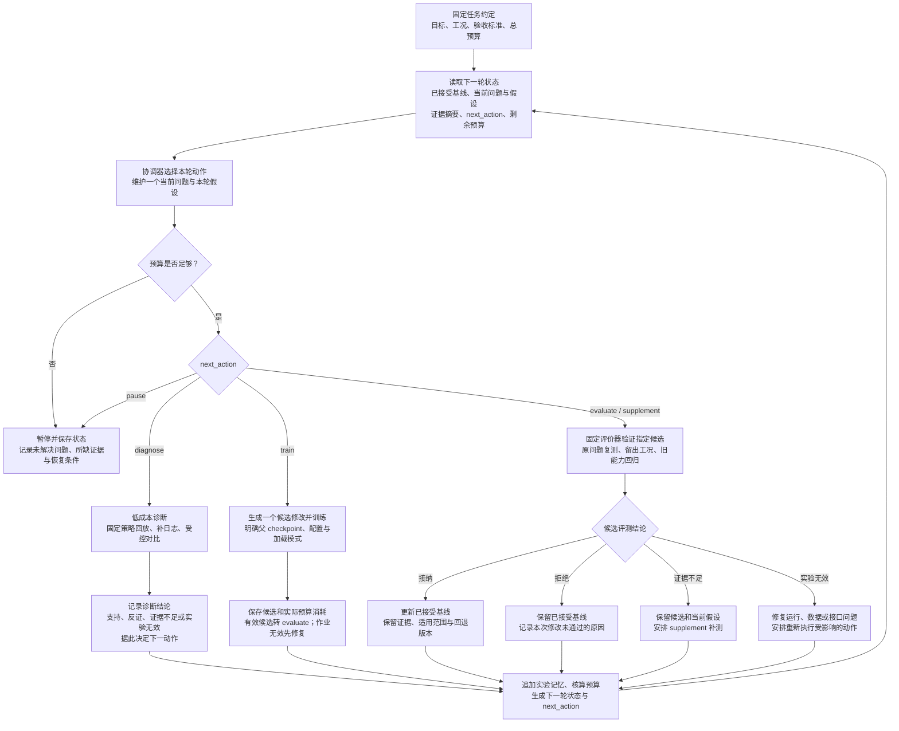

# 如何让一次实验的结果能成为下一次实验的输入

> 日期：2026-11-08（新加坡时间）  
> 版本：设计稿 v0.1  
> 应用场景：MicroDuck 的 RL 训练、策略回放与跨仿真评测  
> 文档性质：结合现有项目记录提出的训练 Harness 设计；文中的状态、实验编号和预算为示意，不代表已经实现或完成新的实验。

**核心目标：在 RL 训练外面增加一个有固定目标、有记忆、有预算、有验收标准的实验闭环，让每次实验缩小下一步的选择范围。**

PPO 内循环负责学习动作；训练 Harness 外循环负责选择问题、组织诊断、提出修改、比较候选，以及决定哪些改进可以保留。一次训练中大量 episode 的失败，先汇总为证据，再选择当前最值得解决的问题。

本文采用一条主线：**一个固定任务、一个当前问题、一个本轮假设**。每次结果写入实验记忆；只有通过验证的候选更新版本基线。

## 总体流程图

下面细化了“执行 → 诊断 → 修复 → 验证 → 推广”的流程。协调器通过 `next_action` 区分诊断、训练和补测，避免证据不足时无意义地重复训练。



流程图中的每次诊断、训练、评测和补测都要先检查预算。失败作业也记录实际消耗。诊断提供修改方向，候选通过独立评测后才能被接纳。

## 第一步：把“主线”写成固定的任务约定

一次围绕明确目标推进的改进过程称为一个 `campaign`。开始实验前，确定任务、工况、主指标、约束、评价器和预算，并保存版本。

以现有舞蹈实验为例，可以选择一个足够小的任务：

| 项目 | 示例约定 |
|---|---|
| 当前任务 | 固定参考舞蹈，在普通地面、固定 4° 坡度和固定坡向下执行 |
| 主指标 | 完成规定舞蹈周期后的根部平面漂移 |
| 必须满足的约束 | 完成动作、不摔倒、动作跟踪质量达到预先约定的门槛 |
| 对照版本 | 一套可定位的 checkpoint、训练配置、参考轨迹、归一化状态与导出模型 |
| 暂缓事项 | 新舞蹈、新材质、触觉、新网络结构 |
| 预算 | 诊断回放数、训练总采样量、评测次数与允许的计算时间 |
| 验收依据 | 固定指标定义、测试场景、数据有效性要求和通过标准 |

对于预期原地完成的舞蹈，可以用有效时间段起终点的平面距离作为漂移指标；若参考动作本身包含移动，则应评价相对参考根部轨迹的偏差。指标含义必须与任务一致。

必须同时检查动作质量：站着不动也可能得到很低的漂移。训练奖励改变后，新旧总回报通常不能直接作为改善依据，应使用独立的行为指标。

**任务范围或验收标准发生实质变化时，建立新的 campaign 或明确的新版本。**评分器及门槛单独版本管理，候选修改不能通过放宽自己的验收条件获得接纳。

**本步产物：**一份固定的任务约定，例如 `campaign.yaml`。

## 第二步：始终只维护一个“当前阻塞问题”

大量失败需要先聚合，避免把同一故障的多个症状当成多个独立问题。例如，一次 reset 之后出现的命令中断、轨迹跳变和视频拼接，应关联到同一个事件。

按以下因素选择当前问题：

1. 对当前目标的阻碍程度；
2. 证据的可信度；
3. 区分可能原因所需的实验成本。

例如，当前问题可以写为：

> 在指定工况下，舞蹈后半段的根部位移持续扩大，导致当前漂移指标未通过。

此时，“支撑脚滑动”“课程变化引起过度补偿”“仿真接触差异”都是候选解释。每轮选择其中一个假设检验，其余进入待办池。

问题与原因分开记录：轨迹中的先后关系可以帮助定位，但不能仅凭日志中的相关性确认原因。

建议把失败分成几个可操作的层次：

| 问题层次 | 示例 | 优先动作 |
|---|---|---|
| 数据与接口 | 日志缺失、时间未对齐、导出后输入语义不一致 | 修复记录或接口，再运行 |
| 执行与时序 | 命令未应用、reset 中断、实际加载策略不符 | 检查执行证据 |
| 行为与策略 | 漂移、摔倒、动作缩水、滑动 | 提出诊断假设 |
| 仿真与迁移 | 同一策略在不同后端表现差异明显 | 检查物理模型与部署约定 |

失败数量不直接决定优先级。高频轻微问题可能不阻碍当前目标，低频失效也可能使整批评测无效。

**本步产物：**一个当前问题、其证据引用和其余问题的待办记录。

## 第三步：搭建一个足够小的训练 Harness

第一版使用一个实验协调器，外接现有训练器与评测程序。

| 模块 | 主要职责 | 输入与输出 |
|---|---|---|
| 实验协调器 | 维护当前问题、选择下一动作、检查预算和状态转移 | 实验状态 → 实验规格 |
| 执行适配器 | 调用现有 mjlab 训练、Isaac 回放或其他已验证运行程序 | 实验规格 → 运行产物 |
| 固定评价器 | 检查数据有效性、计算行为指标、比较候选与基线 | 运行产物 → 评测报告 |
| 实验存储 | 保存配置、版本、轨迹、视频索引、结论和父子关系 | 不可变证据包＋可重建状态摘要 |

LLM 可以作为协调器调用的提案函数，帮助整理失败、提出假设和生成候选补丁。预算核算、验收标准和基线更新通过明确规则执行。

每次执行至少关联以下信息：

- 实际代码、配置、参考轨迹、checkpoint 和导出策略的身份；
- 请求命令、实际应用命令及应用时刻；
- 状态轨迹、接触信息、reset 原因和视频引用；
- 场景参数、随机种子、运行时长、数据缺失或无效标记；
- 预算预计消耗和实际消耗。

已有日志缺少某个字段时，标为未知或缺失，不能补成看似真实的测量值。记录器通过已有输出或异步接口采集数据，避免阻塞实时控制。

**本步产物：**训练、回放、评测三个适配接口，以及统一实验包格式。

## 第四步：把实验结果转成下一轮可读取的状态

下一轮输入是一份受控摘要，保留任务、已接受基线、当前问题、假设、最近结论、下一动作和预算。原始日志通过引用按需读取。

以下 YAML 仅展示字段设计；编号、证据路径和预算均为示例：

```yaml
schema_version: 1
campaign_id: dance_drift_01
campaign_contract: campaigns/dance_drift_01/campaign.yaml

accepted_baseline_id: baseline_003
active_issue: 后半段持续漂移
active_hypothesis:
  id: hypothesis_007
  statement: 支撑阶段脚底滑动贡献了主要漂移
  status: inconclusive

evidence_refs:
  - runs/run_017/state_trace.csv
  - runs/run_018/support_foot_analysis.json

latest_conclusion: 尚缺实际接触状态，无法确认支撑阶段是否滑动
next_action: diagnose
next_action_reason: 补充接触日志，对同一基线执行配对回放

budget_remaining:
  diagnostic_rollouts: 6
  candidate_training_runs: 2
  evaluation_rollouts: 40

pending_candidate_id: null
```

`next_action` 建议使用有限枚举：

| 值 | 含义 |
|---|---|
| `diagnose` | 补日志、固定策略回放、执行低成本区分实验 |
| `train` | 实现候选修改并训练 |
| `evaluate` | 对已保存候选执行固定评测 |
| `supplement` | 围绕同一候选补充评测证据 |
| `pause` | 预算耗尽或前提条件缺失，保存状态 |

### 两种记忆分别管理

**版本记忆**记录当前接受的策略、配置、参考动作、归一化状态、代码与评价器引用，以及回退版本。只有接纳候选时才更新。

**实验记忆**记录每次动作的假设、修改、实际成本、证据、结果和适用条件。每轮追加，保留历史。假设结论可以是 `supported / contradicted / inconclusive`，数据无效另行标记。

候选未改善不必然说明原因假设错误，也可能是修改强度、训练效果或实验设计不足。结论应限制在本次证据范围内。

建议使用如下结构组织未来工具；这是目录建议，并非当前仓库已有实现：

```text
campaigns/dance_drift_01/
├── campaign.yaml
├── state.yaml
├── experiments.jsonl
├── baselines/
│   └── baseline_003.json
└── runs/
    ├── run_017/
    │   ├── spec.yaml
    │   ├── provenance.json
    │   ├── metrics.json
    │   ├── decision.json
    │   └── artifacts.json
    └── run_018/
```

大型 checkpoint、轨迹和视频可以保存在外部产物存储中，实验包记录稳定位置、内容哈希及访问说明。

**本步产物：**可以从历史记录重建的下一轮状态，以及可定位的原始证据。

## 第五步：每个假设都带预测、最小实验和退出条件

一个可执行的假设至少包含：

| 字段 | 需要回答的问题 |
|---|---|
| 假设 | 当前原因解释是什么？ |
| 预测 | 如果解释成立，应观察到什么？ |
| 区分实验 | 哪个低成本实验能增加或减少对它的支持？ |
| 控制条件 | 哪些策略、场景或初始化条件保持相同？ |
| 结果解释 | 支持、反证或不足分别意味着什么？ |
| 退出条件 | 在什么预算或证据条件下停止追查？ |

以脚底滑动为例：

> **假设：**支撑阶段滑动是当前漂移的重要来源。  
> **预测：**漂移增大的时段，支撑脚相对地面出现明显移动。  
> **最低成本实验：**固定策略和场景，记录接触状态、足部世界坐标与根部轨迹，执行配对回放。  
> **结果解释：**若滑动与漂移在相应时段一致，获得支持线索；若没有对应滑动，则降低对该解释的信心；若接触数据缺失，则继续标为证据不足。  
> **后续行动：**有支持证据且值得投入时，训练一个针对支撑约束的候选，保持其他主要训练因素一致。  
> **退出条件：**耗尽预设诊断预算仍不能区分，标记为未解决，并重新选择当前问题下的假设。

先后关系仍不足以证明原因。后续通过受控修改，检查行为是否按预测变化，才能增强原因判断。

候选修改应围绕一个主要假设展开。诊断中改变过的场景参数需要注明用途，候选验收仍使用预先约定的评测工况。

**本步产物：**一份可被执行、可以失败、带退出条件的实验规格。

## 第六步：用四种结果控制下一步，并明确版本初始化

候选评测结果分为四类：

| 结果 | 基线是否更新 | 下一步 |
|---|---|---|
| `accepted`：接纳 | 是 | 保存完整版本包，按适用范围继续当前任务 |
| `rejected`：拒绝 | 否 | 记录未通过原因，决定调整或更换假设 |
| `inconclusive`：证据不足 | 否 | 保留同一候选，安排 `supplement` |
| `invalid`：实验无效 | 否 | 修复数据、运行或接口，再执行受影响的动作 |

诊断阶段的“支持假设”与候选评测的“接纳版本”是不同判定。诊断结果不能直接晋升策略。

补测可以只增加回放次数、补充训练种子的结果或核验异常轨迹。若决定重新训练，需登记新的实验规格、父版本和成本。

### 初始化来源是实验规格的一部分

每个训练实验明确记录：

- 父 checkpoint 和策略配置；
- 归一化状态及其继承方式；
- 优化器、学习计数和课程状态的加载方式；
- 从头训练、warm-start 或 resume；
- 本次新增成本及沿父版本累计的训练成本。

三种模式的建议语义：

| 模式 | 目的 | 必须明确的状态 |
|---|---|---|
| 从头训练 | 检查配方能否独立学成 | 初始权重、随机种子与全部初始化 |
| warm-start | 从已有策略尝试新任务或新配方 | 继承哪些权重与归一化状态，重置哪些训练状态 |
| resume | 继续同一个训练过程 | checkpoint、优化器、计数器、课程与相关状态的恢复 |

具体加载行为以训练器实现为准，不能只根据模式名称推断。

拒绝候选后，下一轮默认从已接受基线开始。若继续沿失败分支训练，需要说明目的，并清楚记录该父 checkpoint。否则容易出现“配置回退，但权重和优化器仍沿失败分支变化”。

所有诊断、补测和失败作业都核算预算。预算耗尽时暂停并保存恢复条件。

**本步产物：**明确的决策记录、初始化来源和更新后的下一轮状态。

## 第七步：把“推广”做成带证据范围的基线更新

候选先在当前问题和开发工况上验证，再检查未参与调参的工况与旧能力回归。重复调参使用的场景属于开发集；最终留出测试应单独管理，限制反复查看造成的选择偏差。

条件允许时，使用配对评测场景降低比较噪声，并使用多个训练随机种子检查训练波动。比较时记录相同的评测协议、训练预算和初始化来源；历史单次回放不能直接替代统计结论。

### 接纳一个完整版本包

被接纳的记录至少包含：

- 代码版本、完整配置、父版本和训练预算；
- checkpoint、归一化状态、参考轨迹与导出模型；
- 评价器、验收标准、测试场景与种子；
- 主要改善、已有能力回归结果和数据有效性；
- 适用范围、仍未验证的条件和回退版本。

例如可以形成如下结论模板：

> 候选版本在约定训练预算和初始化条件下，改善了指定舞蹈及指定地面工况的漂移，并通过所列动作质量与回归检查。证据仅覆盖本记录中的工况；新材质、新舞蹈及实机效果另行验证。

上句是结论格式示例，不是本项目已取得的结果。

### 推广范围逐步扩大

| 层次 | 接纳范围 |
|---|---|
| 当前工况 | 仅作为该舞蹈和特定场景的专项配置 |
| 同一技能 | 多工况通过后，进入舞蹈技能基线 |
| 共享训练组件 | 跨技能验证后，再进入共享配方或组件 |

这与已有 `usage / evidence / contract` 的设计可以衔接：使用状态、证据状态和接口契约各自有来源，单次通过保留其实际范围。

**本步产物：**带适用范围的新基线，以及可以支撑未来实验的经验记录。

## 第一版工程切片：先跑通记录、比较、决策和继承

第一版可以由人选择当前问题并写假设，工具负责执行、记录和比较。之后再逐步自动化诊断与补丁生成。

建议用已有舞蹈 V3/V4 做第一个试点：

1. 导入已有记录，明确标记为历史单次回放，保留缺失字段；
2. 固定一项任务及评价器，登记可定位的对照版本；
3. 接入现有回放程序，生成可追溯的新实验包；
4. 比较同工况下的基线与候选；工况不一致时明确分开；
5. 写入四类决策之一，生成下一轮 `state.yaml`；
6. 下一次运行自动读取该状态，复用正确的基线、候选和初始化来源。

第一版的验收标准：

- 能从一个 `run_id` 定位配置、模型、证据和结果；
- 能解释下一轮为什么选择这个问题与动作；
- 拒绝候选时基线保持不变；
- 证据不足时能够补测同一候选；
- 实验无效时能够识别受影响的数据并重执行；
- 接纳后能够追溯新基线的依据和回退版本；
- 预算耗尽后可以暂停、保存并恢复；
- 进程重启后可从实验记忆重建下一轮状态。

## 如何吸收后续论文与工程想法

每个新想法先形成一张实验卡：

```yaml
source: 论文或工程资料链接
target_failure: 它要解决的已有失败
required_evidence: 采用前还需补充的数据
minimal_change: 最小候选修改
comparison: 对照版本与公平比较方式
acceptance: 固定行为指标与约束
budget: 最低验证成本及退出条件
scope: 预期适用范围
result: 待实验填写
```

优先选择能帮助当前阻塞问题的想法。其他想法保留在待办池。一个新想法通过同样的证据链后，才成为后续实验默认使用的能力。

## 资料与设计依据

- [RoboFoundry 论文](https://arxiv.org/abs/2609.32862)：执行经验驱动、经验证的系统更新，为本文外层闭环提供研究启发。本文将其迁移到 MicroDuck RL 实验管理，属于工程设计建议。
- [my-microduck 项目](https://github.com/ReadbytheBeach/my-microduck)：项目背景与现有文档。
- [视频驱动舞蹈 V1–V4 进展](https://github.com/ReadbytheBeach/my-microduck/blob/main/sessions/02-MicroDuck视频驱动舞蹈V1-V4进展.md)：已有训练与回放记录、V4 漂移问题，以及固定种子单环境回放的局限。
- [语言控制方案操作手册](https://github.com/ReadbytheBeach/my-microduck/blob/main/guides/语言控制MicroDuck方案操作手册.md)：现有会话、ACK、评价器及分级验收记录。
- [网关规则](https://github.com/ReadbytheBeach/my-microduck/blob/main/guides/网关的规则.md)：使用状态、证据、契约和独立验收的设计。
- [新皮质设计提案](https://github.com/ReadbytheBeach/my-microduck/blob/main/docs/design/鸭子新皮质_设计v1.md)：未来分层与离线迭代方向；不作为已实施功能的证据。
